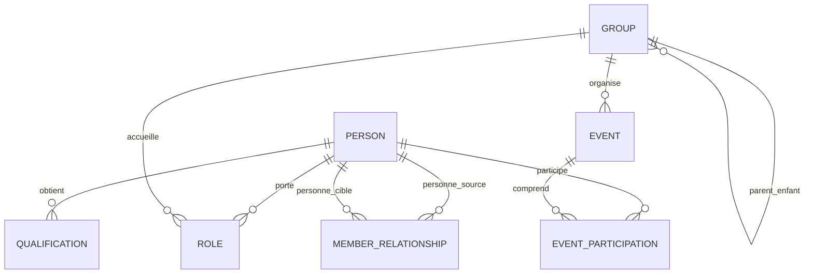

# EEDS 2529 — Dossier de référence fonctionnel et métier
## Synthèse de l'application de gestion des Éclaireuses et Éclaireurs du Sénégal (EEDS)

> **Document de contexte destiné à une IA, à une équipe de conception ou de développement.**
>
> Ce dossier consolide les éléments connus issus des échanges précédents, des documents statutaires, du précis de branche Toor-Toor wi, de la stratégie EEDS et du plan d'action 2025. Il sert de base de travail, de contexte métier et de référentiel de conception.
>
> **Important :** il distingue les règles documentées/confirmées (`[CONFIRMÉ]`), les déductions raisonnables (`[À CONFIRMER]`) et les fonctionnalités proposées pour structurer l'application (`[PROPOSITION]`). Ne pas transformer une proposition en règle officielle sans validation des EEDS.

---

## 1. Résumé du projet

Le projet consiste à mettre en place une application numérique de gestion et de structuration des Éclaireuses et Éclaireurs du Sénégal (EEDS), mouvement scout national fondé en 1937. L'application doit permettre de gérer de façon cohérente les membres, les structures territoriales et organisationnelles, les unités et branches, les responsables et leurs fonctions, les adhésions et cotisations, la progression éducative, les formations, les activités, les projets, les données administratives et les rapports.

L'application doit refléter la réalité organisationnelle et pédagogique du mouvement et non se limiter à un registre de personnes. Elle doit soutenir les processus de gestion des membres et des cadres, la vie des unités, le pilotage des structures de base et des instances nationales, la redevabilité, la coordination des projets, ainsi que le déploiement de la stratégie EEDS.

### Objectifs généraux
- Constituer un référentiel national fiable et centralisé des membres et structures.
- Structurer l'association selon sa hiérarchie, ses branches, unités et fonctions.
- Faciliter l'adhésion, le renouvellement, la mutation et le suivi du statut des membres.
- Permettre aux responsables autorisés de gérer les membres de leurs structures.
- Suivre la progression éducative des jeunes selon leur branche et les référentiels de progression.
- Gérer les responsabilités, nominations, mandats et parcours de formation des ressources adultes.
- Organiser et documenter activités, camps, événements, projets et actions communautaires.
- Faciliter le suivi des cotisations et, à terme, de certaines opérations financières liées aux membres.
- Produire des statistiques, listes, rapports et tableaux de bord à différents niveaux.
- Soutenir la transformation numérique, la mesure de l'impact, la gouvernance et les exigences de redevabilité/GSAT.
- Permettre une communication et une circulation de l'information structurées entre les échelons.

### Périmètre de conception
- Application web responsive, utilisable sur ordinateur, tablette et téléphone.
- Accès différencié selon les rôles et la structure de rattachement.
- Gestion multi-structures, multi-niveaux et multi-branches.
- Référentiel central national, avec visibilité et droits adaptés à chaque échelon.
- Architecture évolutive : l'application pourra accueillir des modules complémentaires.

---

## 2. Contexte institutionnel et identité du mouvement

### 2.1 Identité
- Nom : Éclaireuses et Éclaireurs du Sénégal (EEDS).
- Association laïque de scoutisme, fondée en 1937.
- Membre de l'Organisation Mondiale du Mouvement Scout (OMMS/WOSM).
- Mouvement d'éducation des jeunes avec l'aide des adultes.
- Association volontaire, non-politique et non-confessionnelle.
- Ouverte aux garçons et filles, dans le cadre de ses règles de branches et unités.
- Couverture nationale du Sénégal.
- Devise : **SERVIR**.
- Mot d'ordre : **PRÊT À SERVIR**.

### 2.2 Mission éducative
Les EEDS cherchent à former des citoyens conscients des enjeux de leur époque et désireux de contribuer à leur résolution, en développant la personne et la communauté. L'application doit donc soutenir la dimension éducative, la participation des jeunes, le service, le développement personnel, les activités et la progression, sans réduire le scoutisme à des données administratives.

### 2.3 Principes statutaires à prendre en compte
Les statuts mentionnent notamment :
- l'adhésion à des principes spirituels et les devoirs qui en découlent, dans le respect du cadre associatif ;
- la loyauté envers le pays et la promotion de la paix, de la compréhension et de la coopération ;
- la participation au développement de la société, au respect de la dignité humaine et de la nature ;
- la responsabilité et le développement personnel ;
- une loi et une promesse adaptées au contexte culturel et contemporain ;
- l'interdiction de la propagande politique ou religieuse au sein de l'association.

### 2.4 Vision et stratégie EEDS
La stratégie esquissée pour les EEDS s'inscrit dans la stratégie mondiale du scoutisme.

**Vision EEDS :** être l'association de jeunesse la plus inspirante et inclusive du Sénégal, qui crée des expériences d'apprentissage transformatrices pour chaque jeune, partout.

**Déclarations d'impact proposées dans la stratégie :**
- Un Sénégal en paix et inclusif.
- Un Sénégal où les jeunes sont au cœur des transformations positives.
- Un Sénégal engagé dans un monde durable.
- Un Sénégal où les jeunes sont épanouis et disposent de possibilités diverses de développement personnel et collectif.

**Priorités stratégiques pour les jeunes et les adultes :**
1. Innover dans le domaine de l'éducation.
2. Disposer de ressources adultes suffisamment nombreuses, bienveillantes, engagées et maîtrisant la méthode scoute.
3. Être au cœur des transformations sociales positives, conduites par les jeunes et les scouts.
4. Valoriser significativement et de manière inclusive le bénévolat aux niveaux local et national.
5. Connecter les scouts et les jeunes pour une citoyenneté impactante.

**Priorités stratégiques pour l'association :**
1. Une association standardisée aux normes GSAT : bonne gouvernance et viabilité financière.
2. Une association capable de s'adapter aux transitions actuelles et futures : mesure de l'impact et transformation numérique.
3. Une association influente : communication, partenariats et plaidoyer.

### 2.5 Plan d'action et activités stratégiques
Les documents de planification 2025 contiennent notamment des actions relatives à :
- la mise en place de comités de personnes ressources pour appuyer des pools ;
- la coordination et l'alignement de projets et conventions (ex. PREPADEM, Transform Health, AMREF) avec les structures de base et zones d'intervention ;
- la mobilisation de bénévoles pour les urgences, catastrophes et actions communautaires ;
- l'appui aux structures de base lors de grands événements et actions de service communautaire ;
- la mise en place de dispositifs de rapportage périodique entre l'équipe nationale et les structures de base ;
- la gestion et l'inventaire du patrimoine ;
- la finalisation et la diffusion d'une charte graphique et de kits de communication ;
- le déploiement d'une communication unifiée, de courriels institutionnels et d'espaces de travail/documentation (JOKKO EEDS) ;
- la formation et le développement des capacités des équipes de communication ;
- la finalisation de manuels administratifs et financiers alignés sur GSAT ;
- l'actualisation de la politique des ressources adultes ;
- la formation des formateurs ;
- la gestion des appels à candidature pour des activités nationales et internationales ;
- le développement du Forum des jeunes, notamment de structures zonales ;
- la création ou l'accompagnement d'unités scoutes universitaires.

**Implication pour l'application :** prévoir des fonctionnalités de planification, d'enregistrement des actions, de suivi de leur statut, de responsables, de dates, de lieux, de moyens, de budgets, de livrables, de reporting et de rattachement aux structures et projets. Ces modules peuvent être développés progressivement et ne sont pas tous nécessairement inclus dans le MVP.

---

## 3. Organisation institutionnelle et hiérarchie

L'application doit modéliser l'organisation institutionnelle des EEDS, les structures territoriales, les organes de direction et les unités éducatives.

### 3.1 Vue hiérarchique générale

Structure institutionnelle/territoriale à représenter :

1. **National**
   - Assemblée Générale
   - Comité Directeur
   - Comité National
   - Équipe Nationale
   - Commissaire Général
   - Commissaires Nationaux / responsables sectoriels / pools
   - Forum national des jeunes (structure de représentation des jeunes, modalités à détailler)

2. **Région**
   - Congrès Régional
   - Comité Régional
   - Équipe Régionale
   - Commissaire Régional
   - Commissaires/assistants sectoriels régionaux
   - Districts relevant de la région

3. **District**
   - Congrès de District
   - Comité de District
   - Équipe de District
   - Commissaire de District
   - Assistants de district
   - Groupes locaux relevant du district

4. **Groupe local**
   - Conseil de groupe local
   - Chef de groupe / responsables de groupe, selon les appellations et nominations
   - Unités de base (une ou plusieurs unités)

5. **Unité de base**
   - Unité correspondant à une branche
   - Membres jeunes
   - Responsables et assistants d'unité
   - Sous-groupes éventuels, notamment pour les branches où ils existent

> Les statuts décrivent les structures et instances. Les noms, limites géographiques, rattachements et mandats réels doivent pouvoir être administrés et adaptés sans modification du code.

### 3.2 Organes et instances statutaires

#### Assemblée Générale (AG)
- Instance suprême de l'association.
- Ordinaire, selon les statuts, tous les trois ans.
- Définit les orientations du mouvement et les grandes lignes du programme.
- Élit le Président et les membres du Comité Directeur ainsi que le Commissaire Général selon les statuts.
- Une AG extraordinaire peut être convoquée selon les modalités statutaires.

**Fonctionnalités applicatives possibles :** archivage des AG, convocations, participants, documents, décisions, procès-verbaux, mandats, élections et suivi des résolutions. `[PROPOSITION]`

#### Comité Directeur
- Gardien des principes, traditions et orientations du mouvement.
- Veille à la conformité du programme aux orientations et décisions de l'AG.
- Participe à la promotion, au développement et à la mobilisation des ressources.
- Le président du Comité Directeur est également Président de l'association.

#### Comité National
- Instance de direction entre deux AG, telle que décrite par les statuts.
- Regroupe notamment des membres de l'Équipe Nationale, des représentants du Comité Directeur, des régions et districts libres.
- Se réunit au moins une fois par an.
- Approuve les projets de programme et de budget et contrôle leur exécution.

#### Équipe Nationale (EN)
- Organe exécutif national, organisé autour du Commissaire Général et des commissaires/secteurs.
- Les secteurs, pools, intitulés et responsabilités doivent être configurables.
- Assure la coordination, la mise en œuvre et le suivi des orientations nationales.

#### Congrès et Comité Régional
- Congrès régional : instance suprême de la région, périodicité statutaire de deux ans selon le texte.
- Élection du Commissaire Régional et investiture de ses collaborateurs.
- Comité Régional : adoption des programmes et budgets, suivi de l'équipe régionale et possibilité de remplacement en cas de carence, selon les statuts.

#### Équipe Régionale
- Coordination entre districts.
- Propositions de nominations de cadres.
- Préparation du congrès régional.
- Gestion des questions administratives et financières.
- Exécution des décisions régionales.
- Reconnaissance des districts, groupes locaux et unités dans la région.

#### Congrès et Comité de District
- Congrès de district : organisé chaque année, réunit les responsables d'unités et les cadres concernés.
- Élection du Commissaire de District et investiture des collaborateurs.
- Comité de District : composé des chefs de groupes locaux réunis autour de l'équipe de district, se réunit au moins deux fois par an selon les statuts.

#### Équipe de District
- Impulse et coordonne les groupes locaux.
- Désigne ou accompagne la désignation des chefs de groupe, selon les règles.
- Applique les décisions du congrès et les directives supérieures.
- Assure la gestion administrative et financière au niveau du district.
- Veille à la formation des cadres.
- Représente le mouvement auprès des autorités au niveau du district.
- Maintient le lien avec la région.

#### Groupe local et Conseil de groupe
- Le groupe local comprend deux unités ou plus selon les statuts.
- Le Conseil de groupe local administre le groupe et est composé des responsables d'unités.
- Le groupe est l'échelon de coordination de plusieurs unités.

### 3.3 Modélisation souple de la hiérarchie
**[PROPOSITION]** utiliser un modèle de structures génériques :
- `Organization / Structure`
- `StructureType` (national, région, district, groupe local, unité, structure autonome, structure universitaire, autre)
- `ParentStructure`
- `Region / District / Group / Unit` (si des entités spécialisées sont nécessaires pour des règles métier)
- `StructureMembership` ou `Affiliation`
- `StructureStatus` (active, inactive, reconnue, en création, suspendue, etc.)
- historique des rattachements et changements de structure.

Cette approche évite d'imposer un nombre fixe de régions, districts ou groupes et permet d'intégrer les structures libres/autonomes et les unités universitaires.

---

## 4. Les branches, unités et catégories de membres

### 4.1 Les quatre branches

Selon les statuts :

| Branche | Nom du membre | Tranche d'âge statutaire (référence) | Unité |
|---|---|---:|---|
| Jiwu wi | Caat | 5–11 ans | Mbootaay |
| Lawtan wi | Arunga | 12–15 ans | Kayon |
| Toor-Toor wi | Jàmbaar | 16–18 ans | Ñawka |
| Meññeef mi | Mawdo | Plus de 18 ans | Gàlle |

Les âges et transitions doivent être configurables. Le système ne doit pas supposer que les seuils d'âge suffisent à déclencher automatiquement une mutation de branche sans règle/validation institutionnelle.

### 4.2 Unités et caractéristiques statutaires

| Unité | Branche | Capacité/structure indiquée dans les statuts | Mixité |
|---|---|---:|---|
| Mbootaay | Jiwu wi | 32 caat | Mixte |
| Kayon | Lawtan wi | 32 arunga | Non mixte, garçons ou filles |
| Ñawka | Toor-Toor wi | 15 jàmbaar | Unité mixte; sous-groupes non mixtes |
| Gàlle | Meññeef mi | 15 mawdo | Mixte |

**[À CONFIRMER]** Les capacités sont des références statutaires et doivent être configurables ou enregistrées comme limites indicatives. L'application devra distinguer capacité cible, capacité maximale et nombre réel de membres.

### 4.3 Terminologie pédagogique et structure
- Caat : membre de la branche Jiwu wi.
- Arunga : membre de Lawtan wi.
- Jàmbaar : membre de Toor-Toor wi.
- Mawdo : membre de Meññeef mi.
- Mbootaay : unité Jiwu wi.
- Kayon : unité Lawtan wi.
- Ñawka : unité Toor-Toor wi.
- Gàlle : unité Meññeef mi.

Le précis de branche Toor-Toor wi contient une terminologie plus détaillée concernant les ensembles, sous-ensembles, responsables, conseillers, composantes de progression, cérémonial et stages. Les appellations et éléments pédagogiques de ce référentiel doivent être conservés comme données paramétrables plutôt que codés en dur.

### 4.4 Groupes et sous-groupes
**[PROPOSITION]** l'application doit permettre :
- l'affectation d'un membre à une unité ;
- l'affectation à un sous-groupe/clan/patrouille/ensemble lorsque la branche le prévoit ;
- le suivi de la composition et des responsables de chaque sous-groupe ;
- le changement de sous-groupe dans l'historique ;
- les règles de mixité configurables par branche et par type de sous-groupe.

---

## 5. Membres et catégories d'adhésion

### 5.1 Qualité de membre
Les statuts indiquent que la qualité de membre repose notamment sur :
- une adhésion libre et volontaire ;
- l'acceptation des statuts et du règlement intérieur ;
- l'appartenance à une unité de base ou une structure de l'association ;
- le versement de la cotisation annuelle.

Les membres comprennent notamment les membres des unités de base, les membres des organes de gestion, des équipes régionales et nationales, du Comité Directeur, les anciens et amis, selon les catégories statutaires.

Les sympathisants peuvent participer à certaines activités sans être soumis à toutes les obligations des membres.

### 5.2 Profil du membre — champs envisagés
**[PROPOSITION]** fiche membre nationale, avec champs adaptés aux jeunes et adultes :
- identifiant unique national (code/numéro membre) ;
- nom, prénom(s) et noms usuels ;
- sexe/genre, si le mouvement le collecte et si nécessaire à la gestion ;
- date de naissance ;
- photo de profil (facultative ou selon règles) ;
- coordonnées : téléphone, email, adresse/localité ;
- personne de contact/parent/tuteur pour les membres mineurs ;
- date d'adhésion initiale ;
- statut d'adhésion et statut opérationnel ;
- branche actuelle ;
- unité actuelle ;
- sous-groupe/clan/patrouille si applicable ;
- groupe local, district, région et rattachement national calculé ou explicite ;
- historique des affiliations ;
- cotisations et reçus ;
- progression éducative ;
- formations, stages et certificats ;
- rôles, nominations et mandats ;
- participation aux activités et camps ;
- consentements, autorisations et documents, avec restrictions d'accès ;
- notes administratives non sensibles, selon droits ;
- date de dernière mise à jour et responsable de mise à jour.

### 5.3 Statuts possibles du membre
**[PROPOSITION — à valider]**
- Pré-inscrit / demande d'adhésion.
- En attente de validation.
- Actif / à jour.
- Actif / cotisation en attente.
- Suspendu.
- Inactif.
- Démissionnaire.
- Radié.
- Décédé.
- Sympathisant / non-membre.
- Ancien membre.

Les statuts doivent être accompagnés d'un historique de changements, de la date, de l'auteur et du motif, avec les droits d'accès appropriés.

### 5.4 Adhésion et renouvellement
Parcours possible :
1. Création ou import d'une fiche.
2. Identification de la structure et de l'unité d'accueil.
3. Saisie/validation des informations.
4. Vérification de l'âge et de la branche cible.
5. Collecte des documents et autorisations applicables.
6. Enregistrement de l'acceptation des statuts/règlement et des consentements nécessaires.
7. Enregistrement de la cotisation.
8. Validation par le responsable autorisé.
9. Activation et génération d'un identifiant/carte de membre.
10. Mise à jour du registre et des statistiques.

**[À CONFIRMER]** Le processus de validation, les pièces justificatives, le système de cotisation, le rôle du parent/tuteur et la politique d'identifiant national doivent être décidés.

### 5.5 Membres mineurs
L'application doit traiter les mineurs avec des protections renforcées :
- informations du parent/tuteur, lorsque nécessaire ;
- autorisations de participation, sortie, camp, photographie ou communication, selon politiques ;
- accès restreint aux données personnelles ;
- pas d'accès direct à des données d'autres jeunes ;
- règles de sécurité et de safeguarding ;
- traitement prudent des informations de santé et d'urgence, si elles sont collectées.

---

## 6. Ressources adultes, responsables, nominations et mandats

Les ressources adultes sont essentielles à l'encadrement, à la formation, à l'administration et au fonctionnement des structures.

### 6.1 Fonctions et responsabilités
Les statuts mentionnent notamment :
- Commissaire Général ;
- Commissaires Nationaux ;
- Commissaire Régional ;
- Commissaires Régionaux / assistants ;
- Commissaire de District ;
- assistants de district ;
- responsables de groupe ;
- responsables et assistants d'unités ;
- responsables de secteurs/pools.

Les appellations et fonctions peuvent évoluer. L'application devrait permettre de créer/configurer des fonctions, titres, responsabilités et périmètres.

### 6.2 Modèle de fonction
**[PROPOSITION]** distinguer :
- `Member` : personne ;
- `Position/Role` : fonction ou rôle ;
- `Appointment` : nomination d'une personne à une fonction ;
- `Structure` : niveau auquel la fonction est exercée ;
- `Term/Mandate` : date de début, date de fin, renouvellement, statut ;
- `AppointmentStatus` : proposé, en attente, validé, actif, expiré, terminé, révoqué ;
- `AppointmentDocument` : lettre de nomination ou autre justificatif ;
- `Replacement/Delegation` : remplacement, intérim ou délégation, si autorisé.

Un membre peut occuper plusieurs fonctions dans différentes structures, mais les règles de cumul et conflits éventuels doivent être configurables.

### 6.3 Historique des responsabilités
Conserver l'historique des fonctions :
- fonction ;
- structure ;
- personne ;
- autorité de nomination ;
- date de nomination ;
- date de prise de fonction ;
- date de fin ;
- statut ;
- documents ;
- commentaires/motif de clôture ;
- intérim/remplacement éventuel.

### 6.4 Ressources adultes et cycle de développement
La stratégie et les documents de plan d'action font référence à :
- politique des ressources adultes ;
- identification et mobilisation des ressources adultes ;
- formation des formateurs ;
- développement et accompagnement des cadres ;
- mentorat et accompagnement ;
- réseaux de personnes ressources ;
- valorisation du bénévolat.

**[PROPOSITION]** gérer un parcours adulte : identification, recrutement/mobilisation, affectation, onboarding, formation, accompagnement, reconnaissance, évaluation, renouvellement ou fin de fonction.

---

## 7. Formation et stages

### 7.1 Objet
Gérer les formations et stages des membres et adultes, leur organisation, inscriptions, participation, validation, certificats et historique.

### 7.2 Objets possibles
**[PROPOSITION]**
- `TrainingCourse` : formation/stage.
- `TrainingSession` : session datée.
- `TrainingCategory` : catégorie (formation scout, leadership, technique, safeguarding, etc.).
- `Trainer` : formateur.
- `TrainingParticipant` : inscription/participation.
- `TrainingAssessment` : évaluation.
- `Certificate` : certificat.
- `TrainingRequirement` : formation requise pour une fonction.
- `TrainingPathway` : parcours de formation.
- `TrainingVenue` : lieu.
- `TrainingResource` : documents et ressources.

### 7.3 Scénarios
- Publier une formation.
- Appel à candidature.
- Réception et validation des candidatures.
- Sélection des participants.
- Inscription/confirmation.
- Suivi des présences.
- Evaluation.
- Validation du stage.
- Génération du certificat.
- Enregistrement dans le parcours individuel.
- Reporting des personnes formées par structure, fonction, région, district et période.

Les documents du Pool Méthodes Educatives mentionnent la formation des formateurs et l'élaboration de procédures d'appels à candidature pour les activités nationales et internationales. Ces workflows pourront être soutenus par l'application.

---

## 8. Programme éducatif, progression et référentiels

### 8.1 Principe
Le programme scout constitue un ensemble de connaissances, savoir-faire, savoir-être, activités, méthodes et objectifs organisés dans une progression éducative. La progression doit être adaptée à la branche, au contexte sénégalais et aux référentiels validés par les EEDS.

### 8.2 Progression individuelle et collective
Le précis Toor-Toor wi distingue notamment :
- progression collective ;
- progression individuelle ;
- pédagogie de la réussite ;
- programme de progression de la branche ;
- éléments symboliques et cérémoniels ;
- suivi administratif et pédagogique.

L'application doit permettre, si le référentiel est validé :
- objectifs ou compétences ;
- activités/expériences permettant de travailler ces objectifs ;
- progression individuelle ;
- progression collective ;
- validation par un responsable/conseiller ;
- dates et preuves éventuelles ;
- observations et prochaines étapes ;
- distinctions, badges, jeegos ou composantes de progression ;
- suivi des validations et historiques.

### 8.3 Programme de Toor-Toor wi — thèmes de référence
Le précis de branche Toor-Toor wi comprend les thèmes suivants :
1. Scoutisme.
2. Éducation à la vie familiale (EVF), y compris les sujets MST/SIDA dans le document.
3. Santé.
4. Éducation relative à l'environnement.
5. Éducation au développement.
6. Éducation aux droits humains.
7. Lutte contre la pauvreté.
8. Culture.
9. Genre et développement.
10. Éducation à la communication (Educom).

Ces thèmes sont des éléments de référence issus du précis. Leur mise en œuvre, leur révision, les contenus détaillés et les modalités de validation doivent être administrés par les responsables pédagogiques.

### 8.4 Composantes et spécialités / jeegos
Le précis contient des composantes de progression et des propositions de spécialités/jeegos, dont :
- Scout conseiller ;
- nutrition diététique ;
- médecine traditionnelle ;
- brevet anti-drogue ;
- démographie ;
- aide aux mineurs ;
- éducation sanitaire ;
- santé de la reproduction ;
- communicateur ;
- environnementaliste ;
- gestionnaire ;
- bon citoyen ;
- humaniste ;
- interprète ;
- enquêteur ;
- genre.

Les libellés, critères, niveaux, preuves, validations et badges doivent être configurables, car le référentiel peut être révisé.

### 8.5 Cadre symbolique et cérémonial
Le précis de branche Toor-Toor wi traite notamment :
- cadre symbolique EEDS ;
- appellations des branches, ensembles, sous-ensembles, membres, instances et responsables ;
- conseillers et responsables ;
- composantes de progression ;
- stages de formation ;
- cérémonial, rassemblements, feu de camp, drapeaux, salut, présentation, hymne, loi et promesse.

**[PROPOSITION]** l'application pourrait gérer un référentiel documentaire et pédagogique, des événements de cérémonial, les étapes de progression ou des ressources. Il n'est pas nécessaire de transformer chaque élément du cérémonial en workflow numérique.

### 8.6 Progression : scénarios
1. Le responsable sélectionne le membre et son référentiel de branche.
2. Le membre consulte (ou le responsable documente) ses objectifs et éléments de progression.
3. Une activité ou réalisation est enregistrée comme expérience/proof.
4. Le conseiller/responsable évalue ou valide.
5. L'état de progression est mis à jour.
6. Une distinction, un jeego ou un niveau est attribué selon les règles.
7. Le système conserve l'historique et permet un bilan.
8. Lors d'un changement de branche, le système conserve les éléments historiques et permet de déterminer ce qui est transférable, selon les règles validées.

---

## 9. Activités, camps, événements et service communautaire

### 9.1 Gestion des activités
**[PROPOSITION]** une activité peut être créée par une structure autorisée :
- titre et description ;
- type (réunion, activité pédagogique, service communautaire, camp, formation, événement, projet, cérémonie, etc.) ;
- structure organisatrice ;
- structures participantes ;
- branche(s) ciblée(s) ;
- dates et horaires ;
- lieu ;
- responsables ;
- participants ;
- objectifs ;
- budget et ressources ;
- statut ;
- documents ;
- communications ;
- autorisations ;
- présence ;
- rapport/bilan ;
- photos/ressources avec contrôle d'accès.

### 9.2 Camps
Fonctionnalités potentielles :
- camp ou événement multi-jours ;
- inscription et liste des participants ;
- unités et structures participantes ;
- équipes d'encadrement ;
- autorisations parentales et de participation ;
- planification/logistique ;
- présence ;
- incidents et sécurité (avec accès très restreint et politique appropriée) ;
- rapports et bilan ;
- ressources et dépenses, si périmètre financier.

### 9.3 Service communautaire
La stratégie et le plan d'action soulignent les actions de service communautaire et l'appui des structures lors d'événements majeurs, d'urgences et de catastrophes.

**[PROPOSITION]** enregistrer :
- action et contexte ;
- communauté bénéficiaire ;
- structure(s) impliquée(s) ;
- bénévoles ;
- besoins et ressources ;
- partenaire ;
- résultats/indicateurs ;
- dates ;
- bilan et preuves ;
- rattachement à un programme/projet stratégique.

---

## 10. Projets, conventions et plan d'action

### 10.1 Gestion de projets
Les EEDS conduisent des projets et conventions et cherchent à mieux les aligner avec les structures de base, leurs zones d'intervention et les priorités stratégiques.

**[PROPOSITION]** objets :
- `Project`;
- `Partner`;
- `Agreement/Convention`;
- `ProjectActivity`;
- `ProjectLocation/InterventionArea`;
- `ProjectIndicator`;
- `ProjectReport`;
- `ProjectBudget` (si le module financier est autorisé);
- `ProjectParticipant/Beneficiary` (selon la nature du projet).

### 10.2 Plan d'action
Le plan d'action Excel utilise une fiche synoptique avec des éléments comme :
- titre/quoi ;
- contexte/justification/pourquoi ;
- objectifs/résultats attendus ;
- démarche de mise en œuvre/comment ;
- acteurs impliqués/qui ;
- lieu ou zone/où ;
- date ou période/quand ;
- coût/combien ;
- moyens logistiques ou matériels/avec quoi ;
- calendrier de réalisation ;
- statut ;
- commentaires et suivi.

Ce modèle peut servir de base à un module d'action-planification.

### 10.3 Workflow de suivi
**[PROPOSITION]**
1. Une structure ou un pool propose une action.
2. L'action est rattachée à une priorité stratégique, un projet, une structure ou un plan annuel.
3. Un responsable est désigné.
4. Les acteurs, zones, dates, moyens et coûts prévisionnels sont définis.
5. L'action est soumise à validation si nécessaire.
6. Les activités sont planifiées.
7. Le statut évolue (à planifier, planifiée, en cours, bloquée, réalisée, annulée, reportée).
8. Des observations et preuves sont ajoutées.
9. Un rapport de réalisation est produit.
10. Les indicateurs/résultats sont consolidés.
11. L'action est intégrée aux rapports de la structure et aux tableaux de bord.

---

## 11. Cotisations, paiements et suivi administratif

### 11.1 Cotisation
Les statuts font de la cotisation annuelle une condition importante de la qualité de membre en règle.

**[PROPOSITION]** gérer :
- cotisation par année ou période ;
- montant, devise, catégories et règles d'exemption/réduction ;
- cotisation individuelle ou mécanisme de collecte par structure ;
- paiement partiel, complet, en attente, exempté, annulé ou remboursé, selon règles ;
- date ;
- mode de paiement ;
- référence ;
- reçu ;
- responsable de l'encaissement ;
- rattachement à membre, unité, groupe, district, région ou national ;
- reporting des cotisations et impayés.

### 11.2 Contrôle et séparation des responsabilités
- Les accès aux opérations de cotisation doivent être définis.
- Les modifications et annulations doivent être journalisées.
- Les données de cotisation doivent être accessibles uniquement aux personnes autorisées.
- La gestion des finances de l'association et la comptabilité complète ne sont pas considérées comme automatiquement incluses dans le MVP.

### 11.3 Ressources et comptabilité institutionnelle
Les statuts évoquent les cotisations, subventions, libéralités, ressources exceptionnelles et diverses recettes, ainsi que la tenue de comptabilités distinctes pour les structures, groupes, districts et régions.

**[PROPOSITION / EXTENSION]** l'application de membres peut fournir des données de rapprochement ou des exports, mais un module comptable complet devra faire l'objet d'un cadrage distinct.

---

## 12. Reporting, statistiques et tableaux de bord

### 12.1 Statistiques nationales
**[PROPOSITION]** tableau de bord national :
- nombre total de membres ;
- membres actifs et en règle ;
- membres par branche ;
- membres par région, district, groupe et unité ;
- répartition des membres selon les dimensions autorisées ;
- adhésions et renouvellements sur une période ;
- progression des effectifs ;
- membres inactifs ou à renouveler ;
- capacité et effectif des unités ;
- responsables et fonctions occupées ;
- mandats expirant prochainement ;
- formations et certifications ;
- progression pédagogique ;
- activités et camps ;
- cotisations ;
- projets et actions ;
- structures actives et structures à accompagner ;
- indicateurs stratégiques.

### 12.2 Rapports territoriaux
Chaque niveau devrait disposer de rapports adaptés à son périmètre :
- région : effectifs, districts, groupes, unités, responsables, activités, cotisations et progression ;
- district : groupes, unités, membres, cadres, activités, cotisations et formation ;
- groupe local : unités, membres, responsables, activités et adhésions ;
- unité : liste des membres, progression, présence, activités et responsables ;
- national : consolidation et comparaison des structures, sous réserve de droits.

### 12.3 Reporting stratégique
Le système pourrait soutenir les indicateurs du plan stratégique et les processus de rapportage périodique, notamment :
- participation des jeunes ;
- diversité/inclusion (uniquement données légitimes, minimisées et protégées) ;
- formation et développement des ressources adultes ;
- bénévolat ;
- activités de service ;
- projets et zones d'intervention ;
- résultats/impact ;
- gouvernance et conformité ;
- couverture et dynamisme des structures.

---

## 13. Communication, documents et ressources

### 13.1 Documents institutionnels
**[PROPOSITION]**
- référentiel de documents ;
- documents statutaires et règlement intérieur ;
- politiques et procédures ;
- référentiels de progression ;
- documents de formation ;
- charte graphique ;
- modèles de documents ;
- plan d'action ;
- rapports ;
- convocations, décisions et procès-verbaux ;
- documents de nomination.

### 13.2 Gestion documentaire
- catégorie ;
- titre ;
- version ;
- date de publication ;
- structure propriétaire ;
- visibilité ;
- audience ;
- fichier ;
- historique des versions ;
- validation/publication ;
- statut archivé.

### 13.3 Communication institutionnelle
Le plan d'action prévoit notamment une communication unifiée, des ressources partagées, des outils institutionnels et le renforcement des relais de communication.

L'application peut :
- publier des annonces ciblées ;
- transmettre des notifications aux responsables ou membres selon les droits ;
- afficher les événements ;
- partager les documents ;
- organiser les communications par structure ;
- fournir des liens vers les espaces externes de communication, sans forcément remplacer les outils JOKKO EEDS ou de messagerie.

---

## 14. Profils utilisateurs et droits d'accès

### 14.1 Principe
Les droits doivent combiner **rôle fonctionnel** et **périmètre organisationnel**. Un utilisateur ne doit pas automatiquement accéder à tous les membres du pays parce qu'il détient un rôle administratif. Le système doit déterminer ce qu'il peut consulter, créer, modifier, valider, exporter et supprimer, et dans quel périmètre.

### 14.2 Profils envisagés

#### Administrateur système
- configuration technique ;
- gestion des utilisateurs et permissions ;
- paramétrage des référentiels ;
- administration de la plateforme.
- L'accès aux données sensibles doit rester contrôlé et journalisé.

#### Administrateur national / gestionnaire national
- gestion ou supervision du registre national ;
- validation/gestion des structures selon les délégations ;
- administration des référentiels ;
- reporting national ;
- gestion de workflows nationaux.

#### Commissaire Général / Équipe Nationale
- supervision nationale ;
- consultation des données de structures et membres dans le cadre de leurs fonctions ;
- suivi de la stratégie, des projets et des rapports ;
- gestion de nominations et décisions selon les délégations.

#### Commissaire National / responsable de pool
- gestion du périmètre sectoriel ;
- activités, formations, projets, indicateurs et rapports relevant du pool ;
- accès à certaines données de membres et structures selon besoin et autorisation.

#### Commissaire Régional
- gestion/supervision de la région ;
- districts, cadres, groupes et unités de la région ;
- validations et reporting régional ;
- activités et projets régionaux.

#### Responsable régional / commissaire sectoriel régional
- gestion de son secteur au niveau régional ;
- accès limité au périmètre et aux informations nécessaires.

#### Commissaire de District
- gestion/supervision du district ;
- groupes locaux, responsables, unités et effectifs ;
- validation, suivi, reporting et coordination.

#### Assistant de District / responsable sectoriel
- actions et gestion dans son périmètre et selon délégation.

#### Chef de Groupe / responsable de groupe local
- gestion des unités du groupe ;
- membres, responsables, adhésions, cotisations, activités et reporting du groupe ;
- opérations de validation selon les droits.

#### Chef d'Unité / responsable d'unité
- gestion des membres de son unité ;
- progression ;
- activités et présences ;
- informations administratives nécessaires ;
- communications et reporting de l'unité.

#### Responsable pédagogique / conseiller de progression
- suivi et validation des progressions relevant de son périmètre ;
- accès aux données pédagogiques nécessaires.

#### Formateur
- gestion des sessions, participants, présences et évaluations ;
- accès aux données de formation nécessaires.

#### Membre adulte
- consultation de son profil ;
- mise à jour de certaines informations ;
- consultation de ses nominations, formations et progression éventuelle ;
- inscriptions aux activités et candidatures selon le fonctionnement.

#### Jeune membre
**[PROPOSITION]** accès adapté à l'âge et aux capacités :
- profil limité ;
- progression ;
- activités ;
- candidatures ;
- ressources pédagogiques ;
- communications ;
- aucun accès aux données d'autres membres, sauf autorisation/organisation appropriée.

#### Parent / tuteur
**[PROPOSITION — à valider]**
- accès limité aux informations des enfants dont il est le responsable légal/tuteur ;
- consultation de certains éléments d'adhésion, activités, autorisations et cotisations ;
- aucune visibilité sur les autres membres ou informations internes sensibles.

#### Ancien / ami / sympathisant
- accès limité aux informations ou activités auxquelles il est autorisé ;
- ne doit pas être automatiquement assimilé à un membre actif ou à un cadre.

### 14.3 Matrice indicative
| Profil | Périmètre | Actions principales |
|---|---|---|
| Admin système | Système | Configuration, sécurité, administration |
| Admin national | National | Référentiels, registre, validations, rapports |
| CG / EN | National ou délégation | Pilotage, supervision, rapports, fonctions |
| Commissaire national | Secteur | Suivi sectoriel, projets, formation, reporting |
| Commissaire régional | Région | Structures, membres, cadres, rapports |
| Commissaire district | District | Groupes, unités, membres, rapports |
| Chef de groupe | Groupe | Unités, membres, cotisations, activités |
| Chef d'unité | Unité | Membres, progression, activités, présence |
| Conseiller pédagogique | Périmètre | Progression et validation |
| Formateur | Session | Formation, participants, présence, évaluation |
| Membre adulte | Individuel | Profil, formations, fonctions, activités |
| Jeune | Individuel | Profil limité, progression, activités |
| Parent/tuteur | Enfants rattachés | Informations/autorisation limitées |
| Sympathisant | Limité | Activités/communication autorisées |

Cette matrice est un point de départ, pas une spécification définitive des permissions.

---

## 15. Objets métier / modèle conceptuel

Le modèle suivant est une proposition de vocabulaire de domaine, à adapter au modèle de données et à la technologie.

### 15.1 Noyau organisationnel
- `Organization` : association nationale.
- `Structure` : entité organisationnelle.
- `StructureType` : national, région, district, groupe, unité, structure libre/autonome, universitaire, etc.
- `Region`.
- `District`.
- `LocalGroup`.
- `ScoutUnit`.
- `SubUnit/Patrol/Clan` : selon les branches.
- `Branch`.
- `UnitType`.
- `StructureAffiliation`.
- `StructureRecognition`.
- `StructureStatus`.
- `StructureHistory`.

### 15.2 Personnes et membres
- `Person`.
- `Member`.
- `Membership`.
- `MembershipStatus`.
- `MembershipYear/Season`.
- `MemberIdentifier`.
- `MemberContact`.
- `ParentGuardian`.
- `EmergencyContact` (données minimisées et sécurisées).
- `Consent`.
- `MembershipDocument`.
- `MemberHistory`.
- `MemberTransfer`.
- `FormerMember`.

### 15.3 Responsabilités et gouvernance
- `Position`.
- `Appointment`.
- `Mandate/Term`.
- `Delegation`.
- `ActingAppointment`.
- `GovernanceInstance`.
- `Meeting`.
- `Agenda`.
- `Attendance`.
- `Resolution/Decision`.
- `Election` (si le périmètre le justifie).
- `MeetingMinutes`.

### 15.4 Branche et pédagogie
- `BranchEducationalFramework`.
- `EducationalObjective`.
- `Skill/Competency`.
- `Theme`.
- `ProgressionStage`.
- `ProgressionRecord`.
- `CollectiveProgression`.
- `IndividualProgression`.
- `ProgressionEvidence`.
- `Counsellor/Advisor`.
- `Badge/Jeego`.
- `BadgeRequirement`.
- `BadgeAward`.
- `ScoutPromise`.
- `ScoutLaw`.
- `CeremonialReference`.
- `EducationalResource`.

### 15.5 Formation
- `TrainingCourse`.
- `TrainingSession`.
- `TrainingCategory`.
- `Trainer`.
- `TrainingParticipant`.
- `Attendance`.
- `Assessment`.
- `Certificate`.
- `TrainingRequirement`.
- `TrainingPathway`.

### 15.6 Activités et événements
- `Activity`.
- `Event`.
- `Camp`.
- `ActivityType`.
- `ParticipantRegistration`.
- `ActivityRole`.
- `AttendanceRecord`.
- `Authorization`.
- `ActivityResource`.
- `ActivityReport`.
- `IncidentRecord` (sécurité et accès très restreints, si applicable).

### 15.7 Projets et planification
- `StrategicPriority`.
- `StrategicPlan`.
- `ActionPlan`.
- `PlanAction`.
- `Project`.
- `Partner`.
- `Agreement/Convention`.
- `ProjectActivity`.
- `InterventionArea`.
- `Indicator`.
- `ProgressReport`.
- `BudgetLine` (si inclusion du suivi budgétaire).
- `Deliverable`.
- `Task`.
- `ResponsiblePerson`.

### 15.8 Cotisation et administration
- `MembershipFee`.
- `FeeRule`.
- `Payment`.
- `PaymentReceipt`.
- `PaymentAllocation`.
- `Exemption`.
- `Refund`.
- `FinancialExport` (si nécessaire).
- `AdministrativeDocument`.

### 15.9 Communication et documentation
- `Announcement`.
- `Notification`.
- `Document`.
- `DocumentCategory`.
- `DocumentVersion`.
- `ResourceLibrary`.
- `CommunicationChannel`.

### 15.10 Audit et sécurité
- `User`.
- `Role`.
- `Permission`.
- `RoleAssignment`.
- `Scope`.
- `AuditLog`.
- `AccessLog`.
- `DataChangeHistory`.
- `SecurityIncident` (si applicable).

---

## 16. Scénarios métier et parcours utilisateur

### Scénario A — Création d'une structure
1. L'administrateur national crée une structure.
2. Il choisit le type (région, district, groupe, unité, autre).
3. Il indique le parent/rattachement.
4. Il renseigne nom, code, localisation et statut.
5. Il affecte les responsables et, si nécessaire, documents de reconnaissance.
6. Le système met à jour la hiérarchie et les périmètres d'accès.
7. Les rapports nationaux/territoriaux prennent en compte la structure.

### Scénario B — Création ou adhésion d'un membre
1. Un responsable ou utilisateur autorisé ouvre une nouvelle adhésion.
2. Il vérifie si la personne existe déjà pour éviter les doublons.
3. Il saisit les données.
4. Il attribue une branche et une structure/unité.
5. Pour un mineur, les informations et autorisations de tuteur sont gérées selon la politique.
6. L'adhésion est soumise à validation.
7. La cotisation est enregistrée ou son statut indiqué.
8. L'adhésion devient active selon les règles.
9. Le système produit un identifiant ou une carte, si cette fonction est activée.

### Scénario C — Renouvellement annuel
1. Le système ouvre une nouvelle période d'adhésion.
2. Les membres existants sont proposés au renouvellement.
3. Les informations peuvent être vérifiées/mises à jour.
4. Cotisation et validations sont enregistrées.
5. Le statut est renouvelé.
6. Les non-renouvelés sont signalés.
7. Le reporting compare les périodes.

### Scénario D — Mutation/transfert
1. Un membre demande ou fait l'objet d'un changement de structure, unité, branche ou groupe.
2. La demande est enregistrée.
3. L'autorité compétente valide.
4. L'affiliation précédente est clôturée sans effacer l'historique.
5. La nouvelle affiliation est activée.
6. Progression et historique sont conservés.
7. Les statistiques des structures sont mises à jour.

### Scénario E — Nomination d'un responsable
1. L'autorité habilitée sélectionne un membre.
2. Elle choisit une fonction et une structure.
3. Elle définit la période/mandat.
4. Elle ajoute la nomination ou document justificatif.
5. La nomination est validée.
6. Les permissions de gestion sont accordées selon le rôle et le périmètre.
7. Le responsable apparaît dans le répertoire.
8. Le système signale la fin ou le renouvellement du mandat.

### Scénario F — Fin de fonction / remplacement
1. Une fonction est clôturée ou un remplacement est enregistré.
2. La date de fin est renseignée.
3. Le système retire ou ajuste les permissions associées.
4. L'historique est conservé.
5. Un nouveau titulaire ou intérimaire peut être nommé.
6. Les structures et rapports sont mis à jour.

### Scénario G — Progression d'un jeune
1. Le membre est associé au référentiel de sa branche.
2. Les objectifs/étapes sont affichés.
3. Le membre participe à une activité ou réalise un élément.
4. Le responsable/conseiller documente la réalisation.
5. Il valide ou demande une complémentarité.
6. Le système met à jour la progression.
7. Une distinction peut être attribuée.
8. Le bilan est disponible au membre et aux responsables autorisés.

### Scénario H — Formation
1. Une formation est créée.
2. Les conditions d'inscription et de sélection sont définies.
3. Un appel à candidature est diffusé.
4. Les candidats sont inscrits.
5. Les participants sont sélectionnés/confirmés.
6. Les présences et évaluations sont enregistrées.
7. Les résultats et certificats sont produits.
8. Les parcours individuels et statistiques sont mis à jour.

### Scénario I — Activité ou camp
1. Une structure crée l'activité.
2. Elle définit objectifs, dates, lieux, responsables et participants.
3. Les inscriptions sont ouvertes.
4. Les autorisations nécessaires sont collectées.
5. Les listes et logistiques sont préparées.
6. Les présences sont enregistrées.
7. Le bilan et les ressources sont ajoutés.
8. L'activité est visible dans les rapports.

### Scénario J — Cotisation
1. Le responsable identifie la période et le membre.
2. Le montant applicable est déterminé.
3. Le paiement est saisi ou importé.
4. Le reçu est produit.
5. Le statut est mis à jour.
6. Le rapport de cotisation est consolidé selon les droits.

### Scénario K — Plan d'action
1. Un pool/structure propose une action.
2. Il renseigne contexte, objectifs, méthode, acteurs, zone, dates, coût et moyens.
3. Il rattache l'action à un plan stratégique, un projet ou une priorité.
4. L'action est soumise à validation.
5. Le calendrier et les responsabilités sont enregistrés.
6. Le statut est mis à jour.
7. Les commentaires, livrables et résultats sont documentés.
8. Un rapport est consolidé.

### Scénario L — Rapport périodique de structure
1. Le système prépare une trame de rapport.
2. Le responsable renseigne les données et activités de la période.
3. Les indicateurs sont calculés ou renseignés.
4. Le rapport est soumis.
5. L'échelon supérieur examine et donne un retour.
6. Le rapport est validé/archivé.
7. Les données alimentent les tableaux de bord.

### Scénario M — Consultation parent/tuteur
**[PROPOSITION — à valider]**
1. Le parent/tuteur est associé au membre mineur de manière vérifiée.
2. Il reçoit un accès limité.
3. Il consulte les informations autorisées.
4. Il répond aux demandes d'autorisation.
5. Il ne peut consulter les données d'autres membres.

### Scénario N — Gestion d'une structure libre ou universitaire
1. Une structure spéciale est créée avec un type adapté.
2. Elle est rattachée au niveau territorial ou national selon la décision.
3. Elle reçoit un statut de reconnaissance/activation.
4. Ses membres et responsables sont enregistrés.
5. Le système lui applique des règles de reporting et de droits spécifiques.
6. Les structures autonomes/universitaires sont incluses dans les rapports appropriés.

---

## 17. Règles métier et contraintes à valider

### Règles documentées
- L'association possède quatre branches avec des unités correspondantes.
- Les statuts précisent les âges, noms des membres et unités.
- Les unités ont des capacités et règles de mixité mentionnées dans les statuts.
- La qualité de membre repose sur une adhésion, l'acceptation des règles, l'appartenance à une structure et la cotisation annuelle, selon les statuts.
- Les sympathisants peuvent participer sans être astreints aux mêmes obligations.
- La qualité de membre peut se perdre par décès, démission ou radiation.
- Les sanctions/radiations sont prises selon les règles statutaires et le niveau compétent.
- Les structures ont des instances, responsables et rôles distincts.
- La comptabilité et le suivi des ressources doivent être organisés à différents niveaux, selon les statuts.

### Règles à valider avant implémentation
- Processus exact d'adhésion, validation et renouvellement.
- Cotisation : montants, périodicité, modalités, exemptions, responsabilités et reçu.
- Identifiant membre : format, unicité, réutilisation ou non.
- Politique de doublons : critères de détection et procédure de fusion.
- Règles de transfert et de mutation.
- Transition automatique ou manuelle entre branches.
- Règles de progression, badges, jeegos et validation.
- Règles de nomination et durée des mandats.
- Cumul de fonctions et délégation.
- Statut des structures libres/autonomes et universitaires.
- Autorisations parentales et données des mineurs.
- Règles de conservation, archivage et suppression des données.
- Données sensibles éventuelles et personnes autorisées à y accéder.
- Workflow de radiation, suspension et réactivation.
- Workflow de candidature et sélection aux événements.
- Validation et publication des rapports.
- Règles de visibilité de la liste nationale des membres.

---

## 18. Sécurité, confidentialité et protection des jeunes

L'application traite des données de jeunes, de mineurs, de bénévoles, de cadres et de structures. La sécurité et la protection des jeunes sont des exigences centrales.

### Principes recommandés
- Accès par rôle et périmètre organisationnel.
- Minimisation des données collectées.
- Protection renforcée des mineurs.
- Séparation des informations publiques, administratives, pédagogiques et sensibles.
- Authentification sécurisée.
- MFA pour les comptes privilégiés, lorsque possible.
- Journalisation des actions sensibles.
- Gestion des sessions et révocation d'accès.
- Contrôle des exports et téléchargements.
- Sauvegardes régulières et test de restauration.
- Chiffrement en transit et au repos, selon les possibilités de la plateforme.
- Gestion de consentements et autorisations.
- Politique de conservation et archivage.
- Procédure de gestion des incidents.
- Aucune donnée de santé ou autre donnée sensible ne doit être collectée sans justification, règles, protections et droits d'accès explicites.

### Protection des jeunes
- Limiter l'accès des adultes aux informations nécessaires à leur fonction.
- Éviter les espaces de communication privés non supervisés, si des communications entre adultes et jeunes sont intégrées.
- Définir des règles de communication et de safeguarding.
- Conserver les autorisations nécessaires aux activités.
- Documenter les politiques de protection.
- Prévoir des accès et actions contrôlés en cas d'incident.

---

## 19. Technologie et historique de développement

### 19.1 Piste technique précédemment explorée
Le contexte antérieur mentionne une application personnalisée **Frappe/ERPNext**, sous le nom de projet/app **`eeds_membership`**, destinée à la gestion des membres scouts.

Environnement de développement évoqué :
- Frappe v15 / ERPNext v15 ;
- bench `eeds-bench` ;
- site local `eeds.local` ;
- application custom `eeds_membership` ;
- URL locale de développement `http://localhost:8000` ;
- installation et configuration de bench/site/ERPNext/custom app ;
- dépannage de ports Redis (notamment 13000/11000) et port web 8000.

**Ce contexte technique est une piste antérieure, pas une décision irrévocable.** Avant de reprendre le développement, vérifier le repository, la version, le modèle existant, les personnalisations, l'état du bench et les décisions récentes.

### 19.2 Architecture technique — exigences générales
**[PROPOSITION]**
- Modularité par domaines fonctionnels.
- Référentiels configurables.
- API pour les intégrations futures.
- Gestion des permissions multi-niveaux.
- Historique/audit.
- Import/export contrôlés.
- Responsive/mobile-friendly.
- Prise en charge des faibles connexions si le besoin est confirmé.
- Internationalisation si nécessaire (français en priorité; autres langues selon stratégie).
- Extensibilité sans dégrader le registre central.

### 19.3 Éléments techniques à vérifier dans le projet existant
- Version de Frappe et ERPNext.
- Version et état du custom app `eeds_membership`.
- DocTypes existants.
- Scripts, hooks, workflows et rapports personnalisés.
- Modifications du framework ou ERPNext.
- Données de test et migrations.
- Permissions et rôles.
- Dépendances.
- Sauvegardes.
- Déploiement et environnement.
- Git/repository et branches.
- Tests existants.
- État des données importées.

---

## 20. Découpage fonctionnel possible (roadmap)

### Phase 1 — Socle et registre national (MVP)
- Organisation et hiérarchie.
- Structures, rattachements et statuts.
- Référentiel branches/unités.
- Registre des personnes et membres.
- Adhésion et renouvellement.
- Recherche, filtres, détection de doublons.
- Mutation/transfert.
- Rôles, périmètres et permissions.
- Historique/audit de base.
- Reporting d'effectifs.
- Import/export.

### Phase 2 — Cadres et gouvernance
- Responsables et nominations.
- Mandats et historique.
- Organes et instances.
- Réunions, participants, décisions et procès-verbaux.
- Reporting sur les fonctions.

### Phase 3 — Cotisations et administration
- Cotisations.
- Reçus.
- Suivi des paiements.
- Exemptions et ajustements selon politique.
- Reporting financier administratif.
- Exports.

### Phase 4 — Programme éducatif
- Référentiels de branche.
- Progression individuelle et collective.
- Compétences, thèmes et étapes.
- Jeegos/badges.
- Conseillers et validations.
- Historique de progression.

### Phase 5 — Formation
- Catalogue et sessions.
- Appels à candidature.
- Inscription et sélection.
- Présence, évaluations, certificats.
- Parcours de formation.

### Phase 6 — Activités et camps
- Activités.
- Camps.
- Inscription.
- Autorisations.
- Présence.
- Bilan.
- Reporting.

### Phase 7 — Plan stratégique, projets et reporting
- Plan d'action.
- Projets/conventions.
- Actions, tâches, livrables.
- Indicateurs.
- Reporting périodique.
- Tableaux de bord stratégiques.

### Phase 8 — Communication, documents et portails
- Référentiel documentaire.
- Notifications.
- Communication ciblée.
- Portail membre.
- Portail jeune.
- Portail parent/tuteur (si validé).
- Bibliothèque de ressources.

Cette roadmap est indicative et doit être réordonnée en fonction des priorités, ressources, risques et capacités de l'équipe.

---

## 21. Principaux écrans envisagés

**[PROPOSITION]**
- Dashboard adapté au rôle.
- Répertoire national des membres.
- Fiche membre.
- Fiche adhésion.
- Liste des structures.
- Vue arbre organisationnel.
- Fiche région/district/groupe/unité.
- Gestion des branches et unités.
- Gestion des nominations et mandats.
- Liste des cotisations.
- Progression individuelle.
- Référentiel pédagogique.
- Catalogue de formation.
- Sessions et participants.
- Activités et camps.
- Plan d'action et suivi.
- Projets et partenaires.
- Rapports.
- Documents et ressources.
- Notifications.
- Paramètres et permissions.
- Audit/logs, réservé aux personnes autorisées.

---

## 22. Données de référence à administrer

**[PROPOSITION]** l'administration doit permettre de gérer sans code :
- branches et âges de référence ;
- noms des membres et unités ;
- types de structures ;
- types de fonctions et titres ;
- rôles et périmètres ;
- statuts ;
- périodes d'adhésion ;
- cotisations et règles ;
- types d'activité ;
- catégories de formation ;
- référentiels de progression ;
- badges/jeegos ;
- documents et catégories ;
- régions, districts, groupes et unités ;
- nomenclatures de projets, partenaires et indicateurs ;
- templates de rapports.

---

## 23. Points de vigilance et limites du dossier

1. Ce dossier constitue une synthèse de contexte et un référentiel initial, pas une spécification finale approuvée.
2. Les règles statutaires sont reprises comme source métier; elles doivent être interprétées et validées par les EEDS.
3. Les fonctionnalités marquées `[PROPOSITION]` sont des pistes de conception.
4. Les seuils d'âge, capacités des unités, règles de mixité, nominations et procédures peuvent nécessiter des clarifications.
5. Le précis de branche Toor-Toor wi est une source pédagogique, mais son référentiel doit être transcrit et validé avant l'implémentation exhaustive de la progression.
6. Les données des mineurs, consentements, autorisations, incidents et informations sensibles nécessitent une gouvernance spécifique.
7. Les données de membre doivent conserver leur historique et éviter les suppressions irréversibles sans procédure.
8. Le système doit soutenir les structures territoriales et les structures spéciales/autonomes, sans imposer une hiérarchie rigide.
9. Le module financier/comptable complet est distinct du suivi de cotisations, sauf décision de périmètre.
10. L'état du code Frappe/ERPNext doit être audité avant toute migration ou reprise.

---

## 24. Glossaire

| Terme | Définition/contextualisation |
|---|---|
| EEDS | Éclaireuses et Éclaireurs du Sénégal |
| OMMS/WOSM | Organisation Mondiale du Mouvement Scout |
| EN | Équipe Nationale |
| CG | Commissaire Général |
| SB / structures de base | Structures locales de fonctionnement, selon nomenclature EEDS |
| Jiwu wi | Branche des caat, 5–11 ans selon statuts |
| Caat | Membre Jiwu wi |
| Mbootaay | Unité Jiwu wi |
| Lawtan wi | Branche des arunga, 12–15 ans |
| Arunga | Membre Lawtan wi |
| Kayon | Unité Lawtan wi |
| Toor-Toor wi | Branche des jàmbaar, 16–18 ans |
| Jàmbaar | Membre Toor-Toor wi |
| Ñawka | Unité Toor-Toor wi |
| Meññeef mi | Branche des mawdo, plus de 18 ans |
| Mawdo | Membre Meññeef mi |
| Gàlle | Unité Meññeef mi |
| Jeego | Composante/specialité de progression, selon référentiel |
| Ressources adultes (RA) | Adultes engagés dans le mouvement, encadrement, soutien, formation ou gestion |
| GSAT | Référentiel d'évaluation de la qualité de gouvernance et de fonctionnement associatif du mouvement scout |
| Pool | Équipe/secteur de travail selon l'organisation EEDS |
| Structure autonome/libre | Structure dont le rattachement ou fonctionnement spécifique doit être administré selon les règles EEDS |
| JOKKO EEDS | Initiative de communication/plateforme unifiée évoquée dans le plan d'action |

---

## 25. Instructions de réutilisation par une IA

Lorsqu'une IA reprend ce projet, elle doit :

1. **Utiliser ce dossier comme contexte métier de départ**, et non comme spécification irréfutable.
2. Distinguer systématiquement les règles statutaires documentées des propositions.
3. Ne pas inventer de règles d'adhésion, de progression, de nomination, de cotisation ou de transfert.
4. Poser des questions uniquement sur les décisions métier réellement manquantes, en regroupant les questions de manière concise.
5. Respecter l'organisation EEDS et les appellations en français et en wolof telles qu'elles sont documentées.
6. Concevoir les données et permissions selon la hiérarchie organisationnelle, les délégations et la minimisation des données.
7. Préserver l'historique des affiliations, nominations, progression et statuts.
8. Accorder une protection renforcée aux données des mineurs.
9. Favoriser un système modulaire, configurable et extensible.
10. Vérifier le code, les documents et les décisions de projet existants avant de proposer des modifications qui pourraient les remplacer.
11. Pour toute proposition de développement, fournir : objectif, acteurs, parcours, règles métier, données/objets, permissions, cas limites, critères d'acceptation et tests.
12. Ne pas considérer les modules de finance/comptabilité, portail parent, communications privées ou gestion d'incidents comme acquis : ils doivent être cadrés et validés.

---

## 26. Sources de consolidation

- Statuts des Éclaireuses et Éclaireurs du Sénégal (document fourni).
- **Précis de branche TOOR TOOR WI — Programme national des jeunes** (document fourni).
- **La nouvelle stratégie pour les EEDS** (document Word fourni).
- Présentation **Nouvelle stratégie pour les EEDS** (PowerPoint fourni).
- **EN-EEDS Plan action 2025** (Excel fourni; onglets de suivi et pools).
- Historique des discussions et éléments de cadrage du projet `eeds_membership` / Frappe-ERPNext.

---

**Fin du dossier de référence.**

# ANNEXE — Inventaire des tables / DocTypes métier et données à identifier

> Cette annexe est un inventaire de cadrage. Les tables ERP/Frappe natives (User, Role, File, Workflow, etc.) doivent être réutilisées quand elles conviennent. Les noms ci-dessous sont des noms métier/conceptuels, pas des DocTypes déjà implémentés. [CONFIRMÉ] renvoie aux concepts documentés dans les sources EEDS; [PROPOSITION] est un modèle à valider.

## A. Principes de modélisation
- Séparer le compte de connexion (`User`) de la personne/membre (`Member`). Une personne peut exister sans compte; un compte ne doit pas constituer à lui seul une fiche membre.
- Distinguer structure organisationnelle, groupe d'appartenance et unité éducative. Une structure est hiérarchique et doit pouvoir contenir des structures enfants, sans codage rigide des niveaux.
- Toute affectation, affiliation, fonction, nomination, cotisation, progression et participation doit être historisable.
- Les listes de valeurs (statuts, types, branches, catégories, etc.) doivent être configurables quand possible.
- Appliquer le moindre privilège et filtrer les données par périmètre organisationnel.
- Les données sensibles des mineurs, safeguarding, santé, incidents et autorisations doivent être isolées, minimisées et accessibles à des rôles restreints.

## B. Comptes, personnes et profils

### B1. `User` (compte système — Frappe standard, à réutiliser)
Données à vérifier/maintenir :
- identifiant du compte, nom d'affichage, email/login, statut actif/inactif;
- mot de passe (géré par la plateforme, jamais stocké dans un DocType métier);
- rôles système attribués;
- paramètres de connexion et préférences;
- dernière connexion (selon les fonctions natives);
- lien vers le profil Member/Person;
- compte invité/compte externe, si applicable.

### B2. `Member` / `EEDS Member` [PROPOSITION]
- identifiant national unique;
- nom, prénom(s), nom usuel;
- date de naissance (et âge calculé, pas stocké si possible);
- sexe/genre, uniquement si collecte approuvée et justifiée;
- photo;
- email, téléphone;
- adresse/localité, région administrative si utile;
- date première adhésion;
- statut de membre et statut opérationnel;
- branche actuelle et unité actuelle (dérivées de l'affiliation active si possible);
- personne de référence / urgence (avec contrôle de confidentialité);
- compte User associé (facultatif);
- identifiants externes/import;
- notes administratives non sensibles, selon droits;
- date et auteur de dernière mise à jour.

### B3. `MemberContact` / `Guardian` [PROPOSITION]
- membre concerné;
- nom et relation (parent, tuteur légal, personne de confiance);
- téléphone, email, adresse;
- contact principal ou secondaire;
- dates de validité;
- autorisation d'être contacté;
- vérification/confirmation, selon processus.

### B4. `MemberConsent` [PROPOSITION]
- membre;
- type de consentement/autorisation (adhésion, image, activité, camp, déplacement, traitement de données, autre);
- version du texte/politique;
- donné par (membre ou responsable légal);
- date, validité, retrait;
- preuve/document;
- statut et périmètre.

### B5. `MemberDocument` [PROPOSITION]
- membre;
- type de pièce;
- fichier;
- date de délivrance/expiration, si applicable;
- statut de vérification;
- vérificateur;
- visibilité/confidentialité;
- structure de rattachement.

### B6. `MemberStatusHistory` [PROPOSITION]
- membre;
- ancien/nouveau statut;
- date effective;
- auteur;
- motif;
- document ou décision de référence.

### B7. `MembershipApplication` / `MembershipRenewal` [PROPOSITION]
- candidat/membre;
- campagne/année d'adhésion;
- structure d'accueil et unité;
- date de demande;
- données/justificatifs requis;
- validations et approbateurs;
- cotisation associée;
- décision, date, motif;
- génération de numéro/carte;
- historique du workflow.

### B8. `MemberRelationship` [PROPOSITION]
- personne A/personne B;
- type de relation (parent/tuteur, fratrie, contact d'urgence, mentor, etc.);
- date de début/fin;
- validation et confidentialité.

## C. Structures organisationnelles et groupes

### C1. `Organization` / `OrganizationalStructure` [PROPOSITION]
Table centrale à hiérarchie récursive :
- identifiant, nom officiel, nom court/code;
- type de structure (national, région, district, groupe local, unité, pool/équipe, structure universitaire, comité, etc.);
- parent structure;
- niveau/type de rattachement (éviter un niveau fixe codé en dur);
- territoire/localité et coordonnées facultatives;
- date de création, date de dissolution/fin;
- statut;
- responsable de référence (via Appointment, non champ exclusif);
- règles/attributs propres au type;
- documents de création;
- capacité/limites éventuelles;
- structure de reporting.

### C2. `StructureType` [PROPOSITION]
- code et libellé;
- description;
- type parent autorisé;
- règles de création et de hiérarchie;
- règles d'affiliation;
- paramètres de validation;
- actif.

### C3. `StructureMembership` / `MemberAffiliation` [PROPOSITION]
- membre;
- structure;
- rôle d'appartenance (membre, soutien, cadre, etc.);
- date de début/fin;
- statut;
- affiliation principale/secondaire (si autorisée);
- origine/destination en cas de transfert;
- validation;
- historique.

### C4. `StructureTransfer` [PROPOSITION]
- membre;
- structure source;
- structure cible;
- date de demande/effective;
- raison;
- approbations source/cible;
- statut;
- historique et documents.

### C5. `Unit` / `ScoutUnit` [PROPOSITION]
Objet spécialisé ou type de structure pour unité éducative :
- nom/code;
- groupe local parent;
- branche;
- type (Mbootaay, Kayon, Ñawka, Gàlle ou nomenclature paramétrable);
- capacité de référence;
- statut;
- date de création;
- équipe d'encadrement liée via nominations;
- règles de composition/mixité à configurer.

### C6. `Subgroup` [PROPOSITION]
Clans, patrouilles, ensembles ou sous-groupes selon branche :
- unité parent;
- type de sous-groupe;
- nom/code;
- branche/référentiel applicable;
- membres et responsable (liens historiques);
- dates et statut;
- règles de composition configurables.

### C7. `Territory` / `Location` [PROPOSITION]
- nom;
- type de localité/territoire;
- parent territorial;
- code administratif si applicable;
- coordonnées facultatives;
- statut.

### C8. `StructureHistory` [PROPOSITION]
- structure;
- événement (création, changement de rattachement, renommage, fermeture, fusion, scission);
- ancienne/nouvelle valeur;
- date effective;
- décision/document;
- auteur.

## D. Fonctions, responsabilités, gouvernance

### D1. `Position` / `Function` [PROPOSITION]
- code, libellé, description;
- catégorie (éducative, administrative, gouvernance, projet, formation, etc.);
- structure/type de structure applicable;
- niveau/périmètre;
- exigences/conditions;
- règles de cumul;
- statut.

### D2. `Appointment` / `Nomination` [PROPOSITION]
- membre nommé;
- fonction;
- structure;
- autorité de nomination;
- date décision, début et fin;
- statut (proposée, approuvée, active, expirée, terminée, révoquée);
- intérim/délégation;
- document de nomination;
- commentaire/motif;
- historique.

### D3. `Mandate` [PROPOSITION]
- nomination ou organe;
- durée;
- dates;
- renouvellement;
- statut;
- décision de début/fin.

### D4. `Delegation` / `ActingAssignment` [PROPOSITION]
- titulaire;
- délégataire/intérimaire;
- fonction et structure;
- périmètre de délégation;
- début/fin;
- autorité et document;
- statut.

### D5. `GovernanceBody` [PROPOSITION]
- type d'organe (Assemblée générale, Comité Directeur, Comité National, etc.);
- structure;
- composition/règles;
- dates de mandat;
- statut.

### D6. `GovernanceMembership` [PROPOSITION]
- membre;
- organe;
- rôle au sein de l'organe;
- dates;
- statut;
- décision.

### D7. `Meeting` [PROPOSITION]
- organe/structure;
- titre, type;
- date/lieu;
- convocations;
- participants;
- ordre du jour;
- procès-verbal;
- statut.

### D8. `MeetingParticipant`, `MeetingAgendaItem`, `MeetingDecision`, `DecisionAction` [PROPOSITION]
- liens réunion/participant;
- points d'ordre du jour;
- décisions, texte, responsable, date d'effet;
- action, échéance, statut, preuve de réalisation.

## E. Branches, pédagogie, progression

### E1. `ScoutBranch` [PROPOSITION]
- code/nom de branche (Jiwu wi, Lawtan wi, Toor-Toor wi, Meññeef mi);
- appellation des membres (Caat, Arunga, Jàmbaar, Mawdo);
- âge indicatif et règles de transition configurables;
- type d'unité associé (Mbootaay, Kayon, Ñawka, Gàlle);
- règles éducatives, mixité et capacité à valider;
- dates de validité/version.

### E2. `EducationalProgram` [PROPOSITION]
- programme/version;
- branche;
- objectifs;
- thèmes;
- structure du parcours;
- date de validité;
- documents/références.

### E3. `ProgramTheme` [PROPOSITION]
Référentiel des thèmes du précis Toor-Toor wi, à conserver avec les libellés et versions sources : Scoutisme; EVF; Santé; Environnement; Développement; Droits humains; Pauvreté; Culture; Genre et développement; Communication éducative (liste à valider et harmoniser seulement par décision, sans modifier la source).

### E4. `ProgressionElement` [PROPOSITION]
- programme;
- branche;
- catégorie (étape, compétence, thème, jeego/spécialité, activité de progression, etc.);
- code, libellé, description;
- critères;
- ordre;
- prérequis;
- version.

### E5. `MemberProgress` [PROPOSITION]
- membre;
- élément de progression;
- date début/validation;
- statut;
- évaluateur/mentor;
- observations non sensibles;
- preuve/document;
- historique.

### E6. `ProgressionAssessment` [PROPOSITION]
- membre;
- évaluateur;
- élément;
- critères/observations;
- résultat;
- date;
- preuve;
- validation/approbation.

### E7. `Jeego` / `Specialty` [PROPOSITION]
- code, nom, branche/version;
- description;
- conditions;
- critères;
- référent;
- date d'entrée en vigueur;
- statut.

### E8. `Ceremony` / `CeremonyRecord` [PROPOSITION]
- type de cérémonie;
- branche/unité;
- membre;
- date;
- étape/engagement/reconnaissance;
- responsable;
- document/preuve;
- statut.

## F. Formation et ressources adultes

### F1. `TrainingCourse` [PROPOSITION]
- code, titre, catégorie;
- objectifs, public cible;
- prérequis;
- programme;
- niveau/certification;
- statut.

### F2. `TrainingSession` [PROPOSITION]
- cours;
- dates, lieu;
- formateur(s);
- organisateur;
- quota;
- statut;
- budget/ressources facultatifs.

### F3. `TrainerProfile` [PROPOSITION]
- membre ou personne externe;
- compétences;
- qualifications;
- disponibilité;
- statut;
- historique.

### F4. `TrainingEnrollment` [PROPOSITION]
- participant;
- session;
- demande/validation;
- présence;
- résultat;
- certificat;
- statut.

### F5. `TrainingAssessment`, `Certificate`, `AdultResourceDevelopment` [PROPOSITION]
- évaluation;
- résultat;
- certification délivrée/expiration;
- parcours adulte (mobilisation, onboarding, formation, accompagnement, reconnaissance, fin d'engagement);
- preuves et historique.

## G. Activités, camps et service communautaire

### G1. `Activity` [PROPOSITION]
- titre, description, type;
- structure organisatrice;
- structures partenaires/participantes;
- branche/public cible;
- dates/lieu;
- objectifs;
- responsable;
- statut;
- documents;
- autorisations;
- budget/ressources facultatifs;
- rapport/bilan.

### G2. `ActivityRegistration` [PROPOSITION]
- activité;
- membre/participant;
- structure/unité;
- inscription;
- approbation;
- statut;
- besoins/logistique minimisés.

### G3. `Attendance` [PROPOSITION]
- activité/session;
- participant;
- présence/absence;
- date/heure;
- enregistré par;
- correction/historique.

### G4. `Camp` / `CampPlan` [PROPOSITION]
- activité-camp;
- dates, lieu;
- équipes;
- logistique;
- participant et autorisation;
- plan d'urgence et contacts;
- statut;
- bilan.

### G5. `CampParticipant`, `CampPermission`, `CampTeam`, `CampIncident` [PROPOSITION]
- participant;
- autorisation parentale/consentement;
- équipe d'encadrement;
- incident et mesures (table d'incident isolée, accès restreint; données minimales).

### G6. `CommunityServiceAction` [PROPOSITION]
- action;
- communauté bénéficiaire;
- partenaire;
- structures et bénévoles;
- zone/date;
- moyens;
- résultats/indicateurs;
- preuves;
- bilan.

## H. Projets, partenaires, conventions, plan d'action

### H1. `Project` [PROPOSITION]
- code, titre, description;
- stratégie/priorité associée;
- responsable;
- structures et zones;
- partenaire(s);
- dates;
- statut;
- résultats/indicateurs;
- budget (si module activé);
- documents.

### H2. `Partner` [PROPOSITION]
- nom/type;
- coordonnées institutionnelles;
- contact;
- domaines;
- relation/accord;
- statut;
- historique.

### H3. `Agreement` / `Convention` [PROPOSITION]
- partenaire;
- projet/structures;
- dates;
- engagements;
- document;
- statut;
- échéances.

### H4. `ActionPlan` [PROPOSITION]
- année/période;
- structure;
- objectifs;
- statut;
- approbateur;
- version.

### H5. `ActionPlanItem` [PROPOSITION]
Champs inspirés de la fiche synoptique du plan d'action : quoi/titre; contexte/justification/pourquoi; objectifs/résultats; démarche/comment; acteurs/qui; lieu/où; période/quand; coût/combien; moyens/avec quoi; responsable; calendrier; statut; commentaire/suivi; rattachement stratégique/projet.

### H6. `ActionMilestone`, `ActionIndicator`, `ActionReport`, `ActionEvidence` [PROPOSITION]
- jalons/échéances;
- indicateurs;
- rapports;
- pièces de preuve;
- auteur/date et validation.

## I. Cotisations et finances limitées au périmètre convenu

### I1. `MembershipFeeCampaign` [PROPOSITION]
- année/période;
- règles et tarifs;
- catégories;
- structures;
- échéance;
- statut.

### I2. `MembershipFee` [PROPOSITION]
- membre;
- période;
- montant;
- exemption/réduction éventuelle;
- statut;
- structure de collecte;
- date;
- reçu.

### I3. `Payment`, `PaymentAllocation`, `Receipt` [PROPOSITION]
- paiement et référence/mode;
- montant/date;
- allocation à une cotisation;
- reçu;
- collecteur;
- annulation/remboursement et audit.

### I4. `FinancialCategory`, `Fund/ProjectFund`, `Budget` [PROPOSITION / EXTENSION]
À considérer uniquement si le périmètre de finance/comptabilité est explicitement retenu. La gestion complète de la comptabilité n'est pas présumée incluse.

## J. Communication, documents et référentiels

### J1. `Communication` / `Announcement` [PROPOSITION]
- titre/contenu;
- audience (structures, branches, profils);
- auteur;
- dates;
- canal;
- statut;
- pièces jointes;
- journal de publication.

### J2. `DocumentCategory`, `InstitutionalDocument` [PROPOSITION]
- catégorie;
- titre/version;
- fichier;
- propriétaire;
- structure;
- visibilité;
- date publication/expiration;
- validation;
- historique.

### J3. `ReferenceData` (ou DocTypes dédiés) [PROPOSITION]
- statut membre;
- statut structure;
- types structure;
- branches;
- types unités/sous-groupes;
- types fonctions;
- types nomination;
- catégories activité;
- types formation;
- types documents;
- modes de paiement;
- statuts de workflows;
- localités/territoires;
- paramètres d'âge/capacité/mixité, selon décisions.

## K. Autorisations, sécurité et audit

### K1. `Role` / `User Permission` (Frappe standard à réutiliser)
- rôles applicatifs;
- restrictions par structure;
- permissions CRUD/export/approbation;
- restrictions de champ et de document si nécessaire.

### K2. `RoleScope` / `PermissionScope` [PROPOSITION]
- utilisateur ou rôle;
- structure/périmètre;
- niveau de permission;
- dates;
- approbateur;
- justification.

### K3. `AuditLog` (fonctionnalité native à utiliser si suffisante)
Tracer création/modification/validation, changement d'affiliation, fonction, cotisation, statut, consentement et accès aux données particulièrement sensibles selon capacité et politique.

### K4. `SafeguardingIncident` / `RestrictedIncidentRecord` [PROPOSITION]
- référence minimale;
- date;
- structure;
- personnes autorisées à traiter;
- statut;
- actions/mesures;
- documents séparés et accès extrêmement restreint;
- éviter toute diffusion dans les rapports ordinaires.

## L. Relations majeures (vue simplifiée)
- `User` 0..1 ↔ 1 `Member` (association facultative; une personne peut ne pas avoir de login).
- `Member` 1 ↔ N `MemberAffiliation`; `Structure` 1 ↔ N affiliations.
- `Structure` 1 ↔ N structures enfants (relation parent récursive); un type de structure gouverne les règles.
- `Member` 1 ↔ N `Appointment`; chaque `Appointment` référence une `Position` et une `Structure`.
- `Member` 1 ↔ N `MemberProgress`; chaque progression référence un `ProgressionElement`/programme.
- `Member` 1 ↔ N `TrainingEnrollment`; chaque inscription référence une `TrainingSession`.
- `Activity` 1 ↔ N inscriptions, présences, rapports et documents.
- `Project` 1 ↔ N actions/activités, indicateurs, rapports et conventions.
- `Member` 1 ↔ N cotisations/paiements (selon période et règle).
- `Structure` 1 ↔ N plans d'action et actions planifiées.

## M. Profil de données à collecter — checklist de cadrage
**Pour toute personne :** identifiant; nom; prénom(s); naissance (si nécessaire); contacts; photo (facultative); statut; historique; compte associé facultatif.
**Pour les jeunes :** branche/unité; sous-groupe; contact parent/tuteur; consentements/autorisations applicables; informations d'urgence minimisées.
**Pour les adultes :** affiliations; fonctions/mandats; formations/qualifications; disponibilités ou compétences seulement si le processus le requiert.
**Pour toute structure :** identifiant/code; nom; type; parent; territoire; dates; statut; documents; responsable via nomination; composition et historique.
**Pour toute nomination :** personne; fonction; structure; autorité; dates; statut; document; délégation/fin.
**Pour toute activité :** titre/type; organisateur; audience; dates; lieu; responsable; participants; autorisations; présence; bilan; documents.
**Pour tout objet soumis à validation :** statut de workflow; demandeur; approbateur(s); dates; commentaire; audit.

## N. Ordre conseillé d'implémentation
1. Référentiels et types de structures.
2. Structure hiérarchique et périmètres d'accès.
3. Fiche Member et comptes User, contacts/tuteurs, consentements.
4. Affiliations, unités, sous-groupes, transferts et historique.
5. Fonctions, nominations, mandats et délégations.
6. Branches, programme et progression.
7. Formations et certificats.
8. Activités, camps, inscriptions, présence et autorisations.
9. Plan d'action, projets, partenaires, conventions, indicateurs et rapports.
10. Cotisations, paiements et reçus.
11. Communications, documents, tableaux de bord et audit renforcé.

## O. Points à trancher avant de figer les DocTypes
- Quels niveaux organisationnels et types de structures sont officiels, et lesquels peuvent être créés par délégation?
- Un membre peut-il avoir plusieurs affiliations actives, plusieurs unités ou plusieurs fonctions simultanément?
- Quelle est la règle de transfert et qui approuve à chaque niveau?
- Les catégories de membres, les statuts et la cotisation conditionnent-ils l'accès aux activités ou fonctions?
- Quels champs sont obligatoires selon branche, âge, adulte/jeune et type d'adhésion?
- Quel niveau peut consulter, modifier, valider, exporter et administrer les données de son périmètre?
- Quelles données sont réellement nécessaires pour safeguarding, autorisations, urgences et incidents, et qui peut les consulter?
- Quelle version du référentiel pédagogique et des jeegos doit être utilisée, et qui peut la modifier?
- Quelles fonctions nécessitent nomination formelle, mandat, délégation ou renouvellement?
- Quels workflows de validation et notifications sont nécessaires?
- Le module financier se limite-t-il à cotisations/reçus ou inclut-il comptabilité, budgets, trésorerie et états?
- Quelles règles de conservation, anonymisation, export et suppression logique s'appliquent?


# ANNEXE — CONSOLIDATION DU RÉFÉRENTIEL GITHUB GalleApp1 / HITOBITO

> Cette annexe consolide les documents métier et techniques du dépôt GitHub `ianjaay/GalleApp1`, branche `chore/mac-dev-redeploy`, consultés le 22 novembre 2026. Elle préserve les décisions documentées, signale les divergences et ne transforme pas les propositions en décisions approuvées.

## A. Sources primaires du dépôt

- `eeds/definition structure et roles.md` : niveaux organisationnels, organes, fonctions, unités, membres, modèle Entity/Members/Positions/Assignments, droits et modules.
- `eeds/reconstitution_detaillee_des_structures_pbs_vers_eeds.md` : correspondance PBS→EEDS, structure cible, branches, rôles, adaptation Hitobito et stratégie de wagon.
- `eeds/TECH_SPEC_HITOBITO_EEDS.md` : modules, champs Person, cotisations, activités, rapports, API, langues, authentification, déploiement et MVP.
- `claude.md` : mémoire d'architecture détaillée Hitobito, classes et DSL, permissions, extensions, wagon EEDS, reprise de fonctionnalités PBS, champs et checklist de réalisation.
- `doc/` : documentation d'environnement et de développement Hitobito (setup, devcontainer, Mac redeploy, guides).

## B. Principes de conception hérités du dépôt

1. Construire un wagon autonome `hitobito_eeds` pour les spécificités EEDS.
2. Ne pas modifier le core Hitobito ni dépendre du wagon PBS.
3. Utiliser les classes STI `Group` et `Role` et le mécanisme de groupes imbriqués Hitobito.
4. Conserver `Person` comme référentiel central de personne, pouvant porter plusieurs rôles et relations à des groupes.
5. Les rôles et permissions sont attachés à des types de rôles et à des groupes; les permissions sont évaluées selon leur portée.
6. Utiliser les migrations dans le wagon uniquement; les champs personnalisés structurés et requêtables doivent être des colonnes ou tables, tandis que les champs optionnels peu interrogés peuvent envisager `MountedAttribute`.
7. Toute extension doit suivre I18n, CanCanCan/Ability DSL, RSpec, Rubocop, conventions wagon et versionnement.

## C. Mapping de la structure PBS vers EEDS (mapping historique)

| PBS / Core | Libellé EEDS proposé | Type / classe proposée dans wagon | Statut |
|---|---|---|---|
| Root | Fédération / racine système | `Group::Root` réutilisé | Mapping documenté |
| Bund | National | `Group::National` | Mapping documenté |
| Kantonalverband | Région | `Group::RegionEeds` ou nom évitant collision | Mapping documenté; collision à vérifier |
| Region PBS | District | `Group::District` | Mapping documenté |
| Abteilung | Groupe Local | `Group::GroupeLocal` | Mapping documenté |
| Biber/Woelfe/Pfadi/Pio/Rover/PTA | Unités/branches EEDS | Types de groupes EEDS | Mapping général, les correspondances exactes doivent rester configurables |

### C.1 Hiérarchie organisationnelle EEDS cible

```text
Root (niveau système / fédération, selon besoin)
└── National EEDS
    └── Région
        └── District
            └── Groupe Local
                ├── Mbootaay (Jiwu wi)
                ├── Kayon (Lawtan wi)
                ├── Ñawka / Dental (Toor-Toor wi)
                └── Gàlle (Meññeef mi)
                    └── sous-groupes pédagogiques (Pegg, Jiyon, Fedde, Suudu)
```

> Le document « définition structure et rôles » représente les sous-groupes comme enfants d'unités et les membres comme membres des unités/sous-groupes. La granularité et les types enfants permis doivent être validés avec le modèle réel Hitobito et les pratiques EEDS. L'arbre doit permettre structures imbriquées et équipes/commissions parallèles sans créer des relations rigides inutiles.

### C.2 Branches et vocabulaire documenté

| Branche | Âges documentés | Unité | Membre / groupe de membres | Sous-groupe |
|---|---:|---|---|---|
| Jiwu wi | 5–11 | Mbootaay | Caat | Pegg |
| Lawtan wi | 12–15 | Kayon | Arunga | Jiyon |
| Toor-Toor wi | 16–18 | Ñawka (également Dental dans un document) | Jàmbaar | Fedde |
| Meññeef mi | 18+ | Gàlle | Mawdo | Suudu |

Encadrement transversal proposé/documenté : Njiit, Reefaan, Rambeen. Les noms, orthographes, équivalences et seuils d'âge doivent être configurables et validés; les seuils d'âge ne doivent pas entraîner automatiquement de changement de branche sans règle et procédure de transition définies.

## D. Catalogue de données Hitobito — objets natifs et extension EEDS

### D.1 Objets natifs centraux (architecture Hitobito)

| Objet / modèle | Responsabilité | Relations et caractéristiques documentées |
|---|---|---|
| `Person` | Référentiel central d'identité et contact; peut être authentifié | `has_many roles`, groupes via roles, qualifications, phone_numbers, additional_emails, social_accounts, households; Devise/2FA/Doorkeeper |
| `Group` | Structure organisationnelle | STI; nested-set (`lft`, `rgt`, `parent_id`, `layer_group_id`); `layer` sert de frontière de permissions; type déclare enfants, rôles, événements, rôle standard |
| `Role` | Association personne–groupe et statut/fonction | STI; classe de rôle imbriquée dans type de groupe; permissions déclarées; type `kind` member/passive/external; terminatable, 2FA, etc. selon classe |
| `Event` | Activité/événement | Modèle core extensible; participation, approbation, types d'événement selon classes/types de groupe |
| `Event::Participation` | Participation/candidature à un événement | Référence du contexte Hitobito et extensions event/course possibles |
| `Qualification` | Qualification/compétence reconnue | Associée à Person; détails de l'implémentation et règles EEDS à cadrer |
| `PhoneNumber`, `AdditionalEmail`, `SocialAccount`, `AdditionalAddress` | Coordonnées structurées | Tables natives mentionnées dans claude.md |
| `Household` | Relations de foyer | Association de personnes; usage exact EEDS à préciser |
| `MountedAttribute` | Champs optionnels key/value montés | YAML/polymorphique; préférer colonnes/table pour données fréquemment filtrées |
| `PaperTrail` / Paranoia | Historique et suppression logique | Architecture technique documentée, à confirmer dans le wagon cible |

### D.2 Groupes et couches (layers)

`Group` est un arbre STI. Les classes de groupes définissent notamment :
- si le groupe est une layer (`self.layer = true`);
- les types enfants permis (`children`/`possible_children`);
- les rôles disponibles (`roles`/`role_types`);
- les types d'événements;
- le rôle membre standard (`standard_role`);
- les types racine (`root_types`).

Les layers servent de limites de portée pour l'accès. La conception des layers EEDS doit être explicitement déterminée (National, Région, District, Groupe, etc.) et testée.

### D.3 Role et Assignment : distinction conceptuelle

Les documents de conception emploient `Position`, `Assignment` ou `Role` selon leur niveau de détail. Pour le modèle Hitobito :
- **Position / Function (concept métier)** : poste ou fonction dans un organe/structure (ex. Commissaire régional, Chef de Groupe, Njiit).
- **Role Hitobito (objet technique)** : affectation d'une Person à un Group avec un rôle spécialisé et des permissions.
- **Mandate / Appointment (concept métier complémentaire)** : période, décision de nomination, début/fin, titulaire, éventuel intérim, historique et statut. Ces données ne doivent être ajoutées séparément que si le rôle natif ne les porte pas suffisamment; étudier les attributs existants et possibilités d'extension avant d'introduire un nouveau modèle.

## E. Dictionnaire métier des données EEDS — champs candidats

### E.1 Personne / membre

| Champ / donnée | Description | Source / statut |
|---|---|---|
| ID Person | Identifiant interne central | Hitobito native |
| Matricule scout (`matricule_scout`) | Identifiant EEDS unique | Spécification GitHub; à implémenter |
| Prénom, nom | Identité civile | Person native, configuration exacte à vérifier |
| Date de naissance | Calcul/validation d'âge | Donnée à gérer; règle de branche à confirmer |
| Genre / sexe | Donnée démographique selon définition et nécessité | Mentionnée dans modèle initial; sens, consentement et accès à valider |
| Adresse / quartier / localisation | Adresse et localisation | Structures natives / extensions à valider |
| Téléphone(s), email(s) | Contact | Tables natives prévues |
| Langue de correspondance | Langue préférée | Inspiré des champs PBS, candidat EEDS |
| Préférence communication numérique | Préférence | Inspirée PBS, candidate EEDS |
| Photo | Photo profil / carte | À cadrer |
| Statut membre | candidat, actif, inactif, etc. | Statuts métier à valider |
| Date d'entrée | Début affiliation | Champ PBS inspirant, candidat EEDS |
| Date de sortie | Fin affiliation | Champ PBS inspirant, candidat EEDS |
| Branche | Jiwu/Lawtan/Toor-Toor/Meññeef | Spécification EEDS |
| Groupe / unité / sous-groupe | Affiliation structurelle | Via Group et Role; éviter champs textuels redondants |
| Profession | Profession/adulte | Spec EEDS |
| Compétences | Compétences et expertise | Spec EEDS; prévoir référentiel/Qualification plutôt que texte libre si recherche |
| Progression | Progression/badges | Spec EEDS; à modéliser en objets dédiés |
| Assurance et expiration | Couverture/validité | Champ prévu, module/historique à préciser |
| Parent/tuteur | Contact responsable d'un mineur | Spec EEDS; relations de personne à préciser |
| Consentements | Autorisation/consentement | Proposition nécessaire, règles et preuves à valider |
| Documents | Pièces attachées | Active Storage candidat, classification et accès à définir |

### E.2 Personne mineure et responsable légal

Le document technique envisage `contact_parent_name`, `contact_parent_phone`, `contact_parent_email`, mais le modèle relationnel recommandé à étudier est une relation entre Personnes (parent/tuteur et enfant) avec attributs relationnels : type de relation, responsable légal, contact principal, autorisations, dates d'effet, statut de vérification. Ceci est une proposition d'évolution, pas une structure approuvée du dépôt. Le portail parent doit limiter l'accès aux enfants explicitement rattachés.

### E.3 Group / Structure

| Donnée | Description |
|---|---|
| ID, type STI | Identifiant et type de groupe |
| Nom, nom court/code | Libellé officiel et code |
| Parent | Groupe parent, hiérarchie |
| Layer / portée | Niveau organisationnel de sécurité |
| Statut | Actif/inactif/à constituer, si retenu |
| Dates | Création, activation, fermeture |
| Adresse / quartier / coordonnées | Localisation |
| Contact(s) | Coordonnées de la structure |
| Site web / hostname | Éventuel site/contact public |
| Banque / compte | Champ inspiré PBS, uniquement si besoin et accès restreint |
| Type de branche / groupe | Structure administrative, pédagogique, organe, commission, projet, etc. |
| Règles enfants | Types enfants permis, paramétrés par classe |
| Effectifs / recensement | Décompte à partir des affiliations/roles, pas une saisie dupliquée |

### E.4 Organe de gouvernance

Le dépôt identifie des organes, mais ne fixe pas encore de schéma technique dédié. Objets/attributs candidats : organe, type d'organe, niveau, structure hôte, composition, membres/délégués, période, séances, convocations, décisions, procès-verbaux et actions. Valider si les organes sont modélisés comme Group, Event, ou une combinaison avec des extensions avant création de tables spécifiques.

### E.5 Fonctions et postes documentés

**National** : Président, Commissaire Général, Commissaire International, Trésorier National, Secrétaire Général, Responsable Communication, Responsable Digital, Commissaires Nationaux, Responsable Formation, Responsable Programme Jeunes.

**Région** : Commissaire Régional, Commissaire Régional Adjoint, Trésorier, Responsable Formation, Responsable Programme, Responsable Communication.

**District** : Commissaire District, Adjoint, Secrétaire, Trésorier, Responsable Formation, Responsable Animation.

**Groupe local** : Chef de Groupe, Adjoint, Secrétaire, Trésorier, Responsable Matériel, Responsable Parents/Supporters.

**Unité (toutes branches)** : Njiit (chef), Reefaan (adjoint), Rambeen (assistant), chef de patrouille/responsable équipe.

Ces listes sont des postes exemples/identifiés dans les documents et ne constituent pas encore une nomenclature exhaustive approuvée. Une personne peut occuper plusieurs fonctions, à des niveaux différents, avec des périodes de mandat.

## F. Catalogue fonctionnel EEDS (features)

| Module | Fonctionnalités identifiées dans GitHub | Réutilisation/extension envisagée |
|---|---|---|
| Structures | National, régions, districts, groupes, unités, sous-groupes; organigrammes | Group STI + nested-set |
| Membres | Fiches, matricule, branche, affiliation, assurance, contacts, compétences | Person + champs wagon et roles |
| Roles/mandats | Affectations, responsables, historisation | Role STI + extension éventuelle mandat |
| Import | Import CSV | Core import + mapping EEDS |
| Cotisations | Subscriptions, payments, invoices | Module EEDS; inspiration hitobito_invoices/sac_cas à examiner |
| Assurance | Échéance et taux de couverture | Champ et reporting; historique à concevoir |
| Activités | Types d'activités, capacité, transport, camps avec nuitée | Event/concern EEDS |
| Camps | Camps, participants, rappels, autorisations parentales | Reprise/adaptation Event::Camp PBS |
| Approbation activités | Chaîne de validation | Fork/adaptation Event::Approval; Unité→Groupe→District→Région→National envisagée selon type |
| Présences | Présence activité | Event participation/extension |
| Recensement | Census/MemberCount, effectifs par branche | Fork/copie PBS, adapté EEDS |
| Progression | Badges, progression | Objets Qualification/Progression à détailler |
| Formation | Gestion formations/courses, stages, candidats | Event/course patterns, à cadrer |
| Rapports | effectifs régionaux, croissance, assurance, participation | Domain services/exports |
| Dashboard | National, Région, Groupe; membres, branches, régions actives, cotisations | UI/analytics |
| Carte membre | QR code | Job + signed URL + ViewComponent |
| Portail parents | accès parent par enfant, information/autorisation | rôle/Ability dédiée et scope relationnel |
| Communications | SMS, communications | Fournisseur et données à confirmer |
| Crise | Module Crisis et permission `crisis_trigger` | Adaptation PBS |
| Restrictions de protection | BlackList | Reprise à évaluer, données extrêmement restreintes et gouvernance/recours à définir |
| Géolocalisation | coordonnées et carte | Refaire pour Sénégal, pas copier bornes CH |
| API | API members, structures, organigramme | Graphiti JSON:API/core, endpoints et permissions à spécifier |
| Mobile | API mobile | Phase future, architecture API à sécuriser |
| Langues | Français, Wolof, anglais envisagé dans spec | Locales FR/WO; EN à décider |

## G. Permissions et profils : mapping de référence

### G.1 Modèle de permission

- Les droits sont déclarés par classes de rôles et DSL Hitobito, agrégés via Ability.
- La portée est liée au groupe/layer et au niveau d'accès autorisé.
- Un membre peut avoir plusieurs roles et groupes.
- Le rôle standard de membre peut être configuré par type de groupe (`standard_role`).
- Des permissions canoniques citées dans claude.md : `layer_and_below_full`, `group_read`, `contact_data`, `admin`, `finance`, `approve_applications`, `impersonation`, `manual_deletion`, `crisis_trigger`.

### G.2 Profils opérationnels candidats (mapping des documents)

| Profil / fonction | Portée métier candidate | Permissions / principes |
|---|---|---|
| Admin système | Global | Administration technique, accès exceptionnel contrôlé |
| Administrateur national | National et descendant | Gestion organisationnelle et membres selon permissions |
| Commissaire Général / Équipe Nationale | National et délégations | Pilotage/coordination, scopes par domaine |
| Administrateur régional / Commissaire Régional | Région et descendant | Gestion/consultation régionale |
| District / Commissaire District | District et descendant | Gestion/consultation de district |
| Chef de Groupe | Groupe et unités enfants | Gestion du groupe, membres et activités selon délégation |
| Chef d'Unité / Njiit | Unité et sous-groupes | Encadrement et données des membres de son unité |
| Adjoint/assistant | Scope délégué | Droits adaptés au rôle et à la délégation |
| Trésorier / finance | Scope structure | Accès financier uniquement nécessaire |
| Responsable formation | Scope structure et formation | Candidatures, formations, validations autorisées |
| Responsable programme | Scope structure | Programme/progression, selon délégation |
| Adult member | Profil personnel et rôles | Self-service limité |
| Jeune membre | Profil personnel adapté à l'âge | Accès réduit; protections renforcées |
| Parent/tuteur | Enfants explicitement liés | Consultation et actions autorisées; jamais accès global |
| Sympathisant / membre passif / externe | Scope limité | Permissions minimales selon Role.kind et type |

> Cette matrice est un cadrage; les permissions finales doivent être définies par domaine (données de contact, membres, finances, formations, événements, protection, documents, administration) et par portée (propre groupe, descendant, région, national), puis testées. Ne pas déduire un droit universel de la seule fonction.

## H. Relations de données (modèle conceptuel à respecter)



> Diagramme conceptuel illustratif. `MemberRelationship`, `EventParticipation` et certaines relations sont des concepts métier/extension à confirmer selon les modèles exacts du core et des wagons retenus; ils ne sont pas présentés comme tables déjà implémentées.

### H.1 Relations à concevoir et vérifier

- Person↔Group : par Role (affiliation/affectation) plutôt que par champs `unite` redondants.
- Person↔Person : liens parent/tuteur, urgence, relations familiales et consentement, avec données minimisées.
- Person↔Role : une Person peut avoir plusieurs Roles; Role appartient à un Group.
- Group↔Group : arbre parent/enfant, types et niveaux autorisés.
- Person↔Qualification : qualifications/formation; dates et preuve.
- Event↔Group : organisation/portée selon les relations core disponibles.
- Event↔Participation↔Person : participation, inscription, statut, présence et autorisation selon extension.
- Role/mandat : période de nomination et historique, à vérifier avec attributs natifs/extension.
- Finance : affectation paiement à personne/structure/campagne et reçus, modèle à spécifier.

## I. Scénarios métier retenus/à formaliser

1. Initialiser les entités nationales et les régions; créer les districts, groupes et unités.
2. Configurer une structure avec sous-structures et organes, en respectant les types enfants permis.
3. Créer/importer une Person, contrôler doublons, générer matricule scout.
4. Affilier un membre à une unité et sous-groupe; créer les rôles appropriés.
5. Recruter un mineur et rattacher un responsable légal; recueillir autorisations.
6. Transférer un membre entre structures, conserver l'historique et les rôles/mandats.
7. Nommer une personne à une fonction; définir début/fin, scope et décision; remplacer/intérim.
8. Renouveler l'affiliation, mettre à jour statut, cotisation et assurance.
9. Enregistrer une formation, candidature, présence, évaluation et qualification.
10. Définir progression, badge/étape, évaluation, validation et historique.
11. Planifier activité/camp, capacité, transport, nuits, participants et autorisations.
12. Soumettre une activité à approbation selon le niveau et la nature de l'activité.
13. Enregistrer présences, incident/situation de protection via workflow confidentiel.
14. Enregistrer cotisation/paiement, reçu, allocations, relances et rapprochement.
15. Produire census/effectifs, rapports d'assurance, participation, croissance et dashboards.
16. Parent/tuteur consulte les informations et autorisations de l'enfant uniquement.
17. Gérer une crise avec droits spécialisés et accès auditables.
18. Gérer les données de restriction/blacklist avec accès exceptionnel, procédure, audit, révision et recours à définir.
19. Exporter/importer CSV et exploiter l'API avec contrôle de scope.
20. Créer commissions, projets et équipes temporaires sans déformer l'arbre principal des structures.

## J. Mapping modules PBS — décisions consignées dans claude.md

| Module PBS | Décision dans mémoire projet | Adaptation EEDS |
|---|---|---|
| Census/MemberCount | Reprendre | Recensement par branche et tranche d'âge EEDS |
| Crisis | Reprendre | Traduction FR/WO et scopes EEDS |
| Camps/Event::Camp | Reprendre | Autorisations, transport, capacité, nuitées |
| BlackList | Reprendre | Adaptation, avec contrôle et gouvernance de données sensibles à définir |
| Event::Approval | Reprendre | Chaîne d'approbation EEDS configurable |
| BSV Reports | Ignorer | Réglementation suisse |
| Geolocations | Transposer | Limites/coordonnées Sénégal |
| Kantonalverband/cantons | Transposer | Régions Sénégal |
| J+S fields | Ignorer | Spécifique suisse |
| `hitobito_youth` | Probablement ne pas inclure | Pas de dépendance aux règles J+S/AHV; copier les patterns utiles au besoin |

La mémoire de projet recommande de copier/adapter les modules utiles plutôt que de dépendre directement de `hitobito_pbs`, pour éviter couplage et migrations suisses. Cette recommandation est un choix de conception documenté, à réévaluer au regard de la licence, de la maintenance et des mises à jour.

## K. Spécification technique du wagon EEDS

### K.1 Structure envisagée

```text
app/hitobito_eeds/
  app/models/group/...
  app/models/eeds/person.rb
  app/models/eeds/group.rb
  app/models/eeds/role.rb
  app/abilities/eeds/...
  app/domain/eeds/reports/...
  app/views/people/_fields_eeds.html.haml
  app/views/people/_details_eeds.html.haml
  config/locales/models.eeds.fr.yml
  config/locales/views.eeds.fr.yml
  config/locales/models.eeds.wo.yml
  config/locales/views.eeds.wo.yml
  db/migrate/...
  db/seeds/groups.rb
  lib/hitobito_eeds/wagon.rb
```

### K.2 Types de groupes proposés

`National`, `RegionEeds` (nom à vérifier pour collision), `District`, `GroupeLocal`, `Mbootaay`, `Kayon`, `Nawka`, `Galle`; organes, commissions, équipes temporaires et sous-groupes doivent être modélisés selon l'analyse des types enfants/permissions.

### K.3 Champs Person candidat wagon

- `matricule_scout` (string, index unique)
- `branche` (enum string; codes à normaliser)
- `unite` : ne pas conserver en doublon si la relation Group/Role permet de la dériver; éventuellement contexte historique
- `assurance_expiration` (date; historique d'assurance à envisager)
- `progression_badges` : proposition initiale JSON; préférer un modèle structuré si validations, requêtes ou historisation nécessaires
- `contact_parent_name`, `contact_parent_phone`, `contact_parent_email` : champs de première spécification; préférer relation Person-to-Person si modèle parent/tuteur évolué
- `profession` (string)
- `competences` : texte/JSON dans la spec; préférer Qualifications/referentiel si recherches/validation

### K.4 Langues

Langues identifiées : Français et Wolof dans les documents techniques; anglais est mentionné dans des échanges de contexte international mais n'est pas une décision explicite de la spec wagon. Ajouter les locales `fr` et `wo`; l'anglais (`en`) à confirmer. Traduire les types de groupes et rôles. La spec rappelle que le format Wolof peut nécessiter des formats date/nombre dédiés.

### K.5 API

Endpoints illustratifs de la spécification de haut niveau :
- `GET /regions`
- `GET /districts/:id`
- `GET /groups/:id`
- `GET /members/:id`
- `POST /assignments`
- `GET /organigramme`

Ces routes sont indicatives; la stratégie API réelle devrait respecter Graphiti/JSON:API, les conventions core, et une permission/scoping testée. Ne pas les implémenter comme routes ad hoc avant audit de l'API native.

### K.6 Stack/versions — à vérifier contre l'environnement courant

`claude.md` documente Ruby 3.2.6, Rails ~8.0, PostgreSQL, Puma, Devise, TOTP, Doorkeeper/OIDC, `delayed_job_active_record`, CanCanCan + DSL, HAML, Bootstrap, ViewComponent, Turbo-Rails, Webpacker/Sprockets, Graphiti, Oat, Draper, nested-set, PaperTrail, Paranoia, Globalize, tagging, Active Storage/S3, monitoring Sentry/Airbrake/Prometheus. Le README/manifest du dépôt et l'environnement en cours doivent être vérifiés avant d'en faire des versions de référence.

## L. Roadmap historique du dépôt

- Phase 0 : cadrage, analyse core/youth/PBS, mapping, mémoire technique, décisions ouvertes.
- Phase 1 : squelette wagon, types, rôles minimaux, locale FR, seeds National + 14 régions, CI.
- Phase 2 : champs Person, imports, vues, locale Wolof.
- Phase 3 : cotisations, camps, Event Approval, assurance.
- Phase 4 : census, Crisis, BlackList, géolocalisation, dashboards, exports, QR, portail parents.
- Phase 5 : SSO M365/Google, 2FA, déploiement, monitoring, documentation FR/WO.

## M. Décisions ouvertes et risques de modélisation

1. Réconcilier `Region` PBS et classe Région EEDS (collision de nom).
2. Définir exactement les layers et limites de permissions.
3. Décider comment modéliser organes, commissions, équipes temporaires, projets et sous-groupes.
4. Confirmer nomenclature/orthographe/âge des branches et règles de transition.
5. Définir les champs de Person et le matricule (format, génération, doublons, fusion).
6. Définir les relations parent/tuteur, consentement, données de protection des mineurs et portail.
7. Définir assurance (types, fournisseur, preuve, renouvellement, historique, rapports).
8. Définir cotisations (campagne, montant par catégorie/structure, exemptions, paiements partiels, allocation, reçu, audit).
9. Définir activités/camps, autorisations, capacité, transport, approbation et incidents.
10. Définir le traitement de données de restriction/blacklist : base légitime, processus, responsables, durée, audit, accès, contestation et suppression. Ne pas implémenter un registre nominatif de restriction sans gouvernance approuvée.
11. Définir la politique de conservation et de protection des données, en particulier mineurs, contacts et incidents.
12. Confirmer SSO (M365/Google), stockage, hébergement, taille et API.
13. Évaluer le coût/maintenance et la conformité de la reprise de code PBS.
14. Vérifier l'implémentation réelle dans la branche : documents ne prouvent pas l'existence des modules en production.

## N. Instruction aux agents IA

Lors de travaux futurs sur ce projet :
- utiliser ce référentiel et les documents GitHub comme sources historiques;
- respecter les termes EEDS documentés et signaler les incohérences sans les corriger silencieusement;
- distinguer **documenté**, **proposé**, **à valider** et **implémenté**;
- auditer le core Hitobito avant d'ajouter une table/association, afin de réutiliser Person, Group, Role, Event, Participation, Qualification et permissions existantes;
- ne pas créer une table User séparée sans démontrer pourquoi le mécanisme Person/authentication du core ne suffit pas;
- privilégier l'affiliation via Role/Group plutôt que des champs redondants de structure;
- faire respecter les scopes et permissions, notamment pour les données financières, mineurs, crise et incidents;
- ajouter tests RSpec et migrations au wagon, jamais au core;
- ne considérer les listes de modules PBS comme des décisions d'implémentation avant audit, adaptation et approbation métier.

---

*Fin de l'annexe de consolidation GitHub.*
