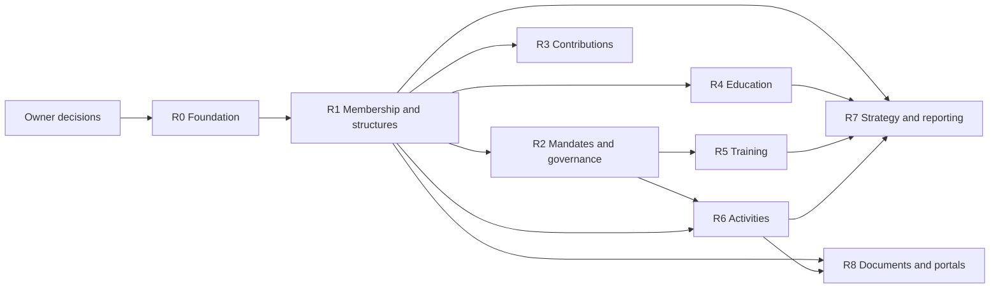

# Dependency map

## Critical dependencies

1. MVP and owner-approved scope
2. Authoritative structure data and hierarchy rules
3. Role/scope matrix and mandate/delegation model
4. Member identifier, duplicate and merge policy
5. Minor/guardian/safeguarding policy
6. Database migration conventions proven on both supported backends
7. Export and audit policy

## Parallel work after R0

Documentation, synthetic fixtures, UI discovery and the database/plugin spike
may proceed in parallel only while their contracts remain separated and no
draft requirement is presented as approved behavior.
